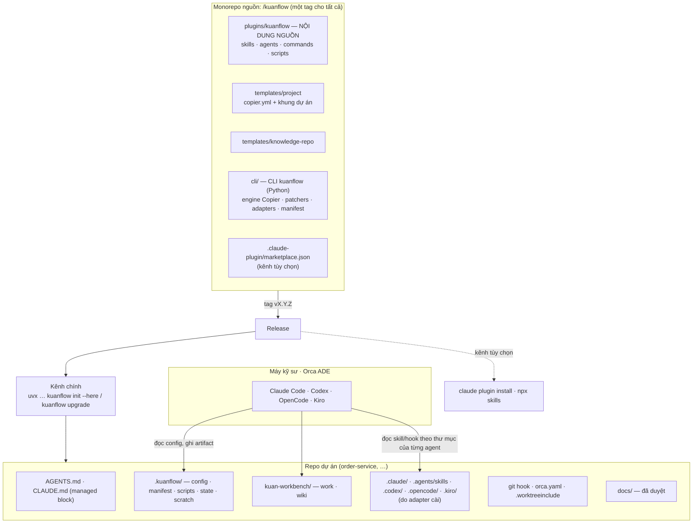
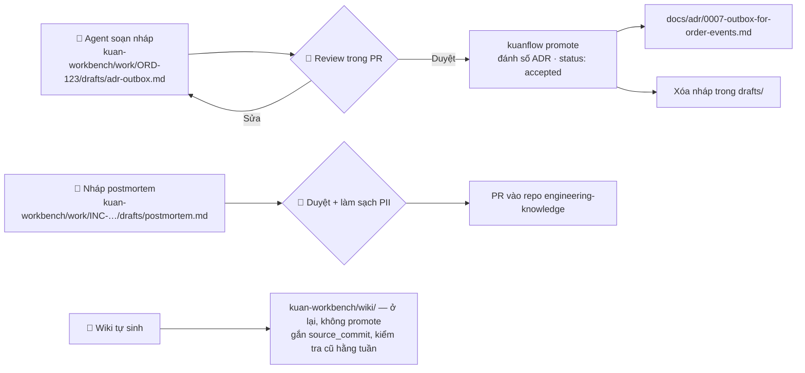
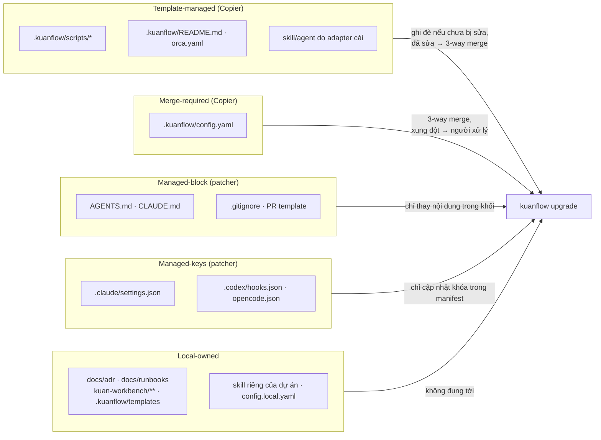
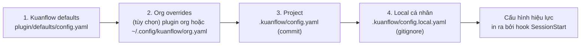
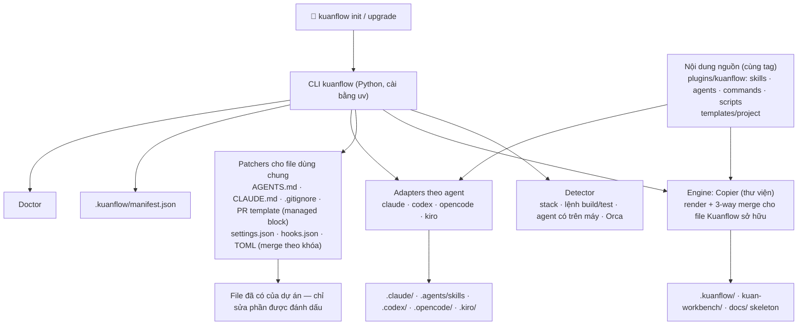
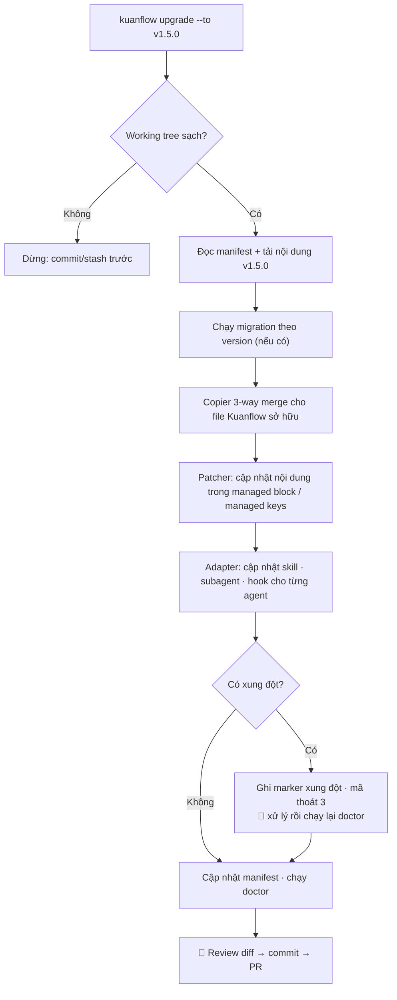
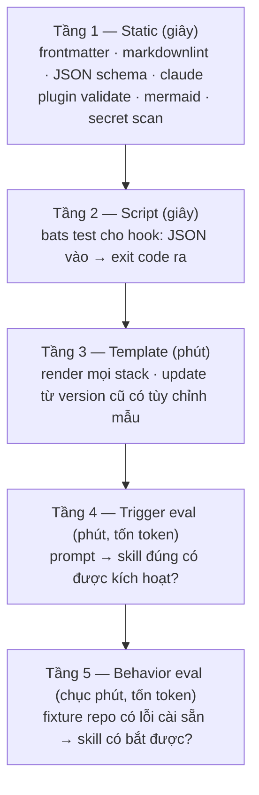
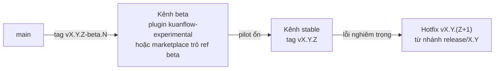
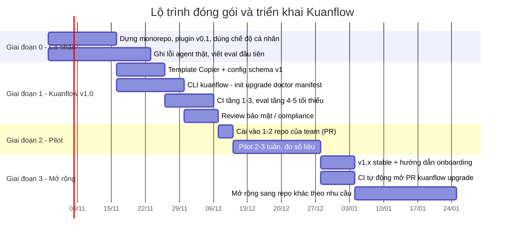

# Đóng gói, triển khai và phát triển Kuanflow
### Hướng dẫn biến playbook thành một bộ cài đặt có version, cài vào dự án có sẵn trong vài phút và cập nhật an toàn về sau

> **Phiên bản:** 1.0 · **Cập nhật:** 10/2026
> **Đi kèm:** `ai-sdlc-workflow-playbook.md` (nội dung quy trình). Tài liệu này trả lời câu hỏi: *đóng gói quy trình đó thế nào, phát hành ra sao, cài vào dự án hiện tại thế nào, và cập nhật về sau mà không phá dự án.*
> **Tên gọi:** bộ đóng gói có tên **Kuanflow**. Quy ước đặt tên: repo `kuanflow`, plugin `kuanflow`, thư mục cấu hình trong dự án `.kuanflow/`, slash command `/kuanflow:<lệnh>`, CLI `kuanflow` (package `kuanflow-cli`), biến môi trường `KUANFLOW_*`. Thay `<org>` bằng GitHub/GitLab org nội bộ.

---

## Mục lục

1. [Bài toán và yêu cầu](#1-bài-toán-và-yêu-cầu)
2. [So sánh các cách đóng gói](#2-so-sánh-các-cách-đóng-gói)
3. [Kiến trúc đề xuất: CLI + nội dung nguồn chung + adapter](#3-kiến-trúc-đề-xuất-cli-kuanflow--nội-dung-nguồn-chung--adapter-theo-agent)
4. [Cấu trúc repo nguồn (monorepo của Kuanflow)](#4-cấu-trúc-repo-nguồn-monorepo-của-kuanflow)
5. [Nội dung nguồn và kênh plugin Claude Code (tùy chọn)](#5-nội-dung-nguồn-và-kênh-plugin-claude-code-tùy-chọn)
6. [Project template (engine Copier)](#6-project-template-engine-copier)
7. [Cấu hình phân tầng: viết skill một lần, chạy ở mọi dự án](#7-cấu-hình-phân-tầng-viết-skill-một-lần-chạy-ở-mọi-dự-án)
8. [Hỗ trợ nhiều agent (Codex, Cursor, Gemini…)](#8-hỗ-trợ-nhiều-agent-codex-cursor-gemini)
9. [CLI `kuanflow` — một lệnh cài, một lệnh cập nhật](#9-cli-kuanflow--một-lệnh-cài-một-lệnh-cập-nhật)
10. [Cập nhật về sau](#10-cập-nhật-về-sau)
11. [Quy trình phát triển Kuanflow](#11-quy-trình-phát-triển-kuanflow)
12. [Kiểm thử và eval](#12-kiểm-thử-và-eval)
13. [Versioning, release channel và changelog](#13-versioning-release-channel-và-changelog)
14. [Governance và đóng góp](#14-governance-và-đóng-góp)
15. [Bảo mật chuỗi cung ứng và compliance](#15-bảo-mật-chuỗi-cung-ứng-và-compliance)
16. [Lộ trình triển khai](#16-lộ-trình-triển-khai)
17. [Xử lý sự cố thường gặp](#17-xử-lý-sự-cố-thường-gặp)
18. [Phụ lục: nội dung file đầy đủ](#18-phụ-lục-nội-dung-file-đầy-đủ)
19. [Nguồn tham khảo](#19-nguồn-tham-khảo)

---

## 1. Bài toán và yêu cầu

Playbook có ba loại "thứ" cần phân phối, và chúng có vòng đời khác nhau:

| Loại | Ví dụ | Giống nhau giữa các dự án? | Tần suất thay đổi |
|---|---|---|---|
| **Hành vi chung** | skill, subagent, slash command, hook, checklist fintech | Có — 100% | Thường xuyên (mỗi retro) |
| **Khung dự án** | `AGENTS.md`, `.claude/settings.json`, `orca.yaml`, thư mục `.kuanflow/` (config, artifact, wiki), `docs/adr`, PR template | Khung giống, nội dung khác (lệnh build, module, service) | Thỉnh thoảng |
| **Tri thức** | postmortem, runbook dùng chung, taxonomy | Dùng chung toàn tổ chức | Liên tục, do con người viết |

**Yêu cầu của bộ đóng gói:**

| # | Yêu cầu | Đo bằng |
|---|---|---|
| R1 | Cài vào repo có sẵn trong ≤ 10 phút, không phá file hiện tại | Thời gian onboarding thật |
| R2 | Cập nhật Kuanflow không ghi đè phần dự án đã tùy chỉnh | Không có "mất thay đổi" sau update |
| R3 | Mọi dự án biết mình đang dùng version nào | File khóa version trong repo |
| R4 | Skill viết một lần, chạy ở mọi dự án (không hard-code lệnh build) | Không có skill chứa `mvn`/`gradle` cứng |
| R5 | Thay đổi Kuanflow được kiểm thử trước khi phát hành | CI + eval xanh trước tag |
| R6 | Rollback được trong vài phút | Ghim lại version cũ |
| R7 | Không rò rỉ dữ liệu, không telemetry ngoài ý muốn | Checklist bảo mật mục 15 |
| R8 | Dùng được với nhiều agent (Claude Code chính, Codex phụ) và chạy trong Orca | Test cài đặt trên từng agent |

---

## 2. So sánh các cách đóng gói

| Cách | Ưu | Nhược | Kết luận |
|---|---|---|---|
| Copy tay file vào repo | Đơn giản | Không cập nhật được, mỗi repo trôi một kiểu | ❌ |
| Git submodule / subtree | Có version | Khó dùng, đặt file sai chỗ agent đọc, xung đột khi tùy chỉnh | ❌ |
| Chỉ `npx skills add` | Đa agent, nhanh | Chỉ phân phối skill; không có hook, command, MCP, khung dự án | ⚠️ dùng làm lớp phụ |
| Chỉ plugin Claude Code | Gói được skill + agent + command + hook + MCP; có marketplace, version, update | Không sinh được file riêng của từng dự án (AGENTS.md, orca.yaml) | ✅ cho hành vi chung |
| Project template (Copier) | Sinh khung theo câu trả lời từng dự án; **update bằng 3-way merge** giữ phần tùy chỉnh | Không phải cơ chế cho hành vi runtime | ✅ cho khung dự án |
| Cookiecutter | Phổ biến | Không có cơ chế update dự án đã sinh | ❌ (dùng Copier) |
| Script bash bọc các công cụ trên | Ít việc | Vẫn cần 4 bộ công cụ; không xử lý file dùng chung, không có manifest | ❌ |
| **CLI riêng `kuanflow`, engine Copier** (giống `specify` của Spec Kit) | Một lệnh cài, một lệnh cập nhật; manifest; patch file dùng chung; adapter đa agent; giữ 3-way merge | Phải viết và bảo trì một CLI nhỏ | ✅ **kênh chính** |

**Quyết định (phương án B):** người dùng chỉ tương tác với **CLI `kuanflow`**. Bên trong, CLI dùng Copier để render và 3-way merge, dùng nội dung nguồn trong `plugins/kuanflow/` cho mọi agent, và ghi manifest. Plugin Claude Code và `npx skills` vẫn phát hành từ cùng monorepo như kênh tùy chọn. Tất cả cùng một tag version.

Lý do chọn Copier: khi cập nhật, nó tái tạo bản cũ của template từ câu trả lời đã lưu, so với dự án hiện tại, áp template mới rồi áp lại các thay đổi riêng của dự án — tức là một phép **3-way merge**. Đây đúng là yêu cầu R2.

---

## 3. Kiến trúc đề xuất: CLI `kuanflow` + nội dung nguồn chung + adapter theo agent



**Nguyên tắc phân chia trách nhiệm:**

| Thứ gì | Nằm ở đâu | Vì sao |
|---|---|---|
| Skill, subagent, command, script guard (nội dung nguồn) | `plugins/kuanflow/` trong repo Kuanflow | Một nguồn duy nhất; plugin Claude và mọi adapter đều lấy từ đây |
| Cách đưa nội dung vào từng agent | Adapter trong CLI | Mỗi agent đọc thư mục/định dạng khác nhau |
| `config.yaml`, manifest, script guard đã cài, khung thư mục | Repo dự án, do CLI quản lý | Phải nằm trong repo để cả team và mọi agent thấy, không phụ thuộc agent |
| Skill riêng của một dự án | `.claude/skills/` / `.agents/skills/` của dự án, đánh dấu local-owned | Không đáng đưa lên Kuanflow |
| Postmortem, runbook dùng chung | Repo tri thức riêng | Do con người duy trì |


---

## 4. Cấu trúc repo nguồn (monorepo của Kuanflow)

```
kuanflow/
├── .claude-plugin/
│   └── marketplace.json              # catalog: liệt kê plugin + version
├── plugins/
│   ├── kuanflow/                  # plugin chính (process + domain chung)
│   │   ├── .claude-plugin/
│   │   │   └── plugin.json           # CHỈ manifest nằm trong .claude-plugin/
│   │   ├── skills/
│   │   │   ├── daily-plan/SKILL.md
│   │   │   ├── clarify-requirements/{SKILL.md, checklists/…}
│   │   │   ├── write-spec/{SKILL.md, templates/spec.md}
│   │   │   ├── research-solution/SKILL.md
│   │   │   ├── verify-agent-output/SKILL.md
│   │   │   ├── fintech-review/SKILL.md
│   │   │   ├── debug-incident/{SKILL.md, scripts/, schemas/}
│   │   │   ├── write-postmortem/{SKILL.md, templates/}
│   │   │   ├── work-report/SKILL.md
│   │   │   └── knowledge-gardening/SKILL.md
│   │   ├── agents/
│   │   │   ├── codebase-locator.md
│   │   │   ├── codebase-analyzer.md
│   │   │   ├── pattern-finder.md
│   │   │   ├── test-writer.md
│   │   │   ├── adversarial-reviewer.md
│   │   │   └── rca-{timeline,change-correlation,code-path,past-incident}.md
│   │   ├── commands/                 # slash command = điểm vào từng workflow
│   │   │   ├── w0-daily.md  w1-clarify.md  w2-spec.md  w3-research.md
│   │   │   ├── w4-plan.md   w5-implement.md  w6-test.md  w7-debug.md
│   │   │   ├── w8-verify.md w9-report.md  w10-capture.md
│   │   │   └── doctor.md
│   │   ├── hooks/
│   │   │   └── hooks.json
│   │   ├── scripts/                  # script guard dùng chung — CLI cài vào .kuanflow/scripts/
│   │   │   ├── load-config.sh
│   │   │   ├── guard-bash.sh
│   │   │   └── guard-protected-paths.sh
│   │   ├── .mcp.json                 # MCP mặc định (ví dụ knowledge search) — tùy chọn
│   │   └── README.md
│   └── kuanflow-experimental/     # plugin kênh beta (tùy chọn)
├── templates/
│   ├── project/                      # Copier template cho repo dự án
│   │   ├── copier.yml
│   │   └── template/                 # _subdirectory: nội dung được render
│   └── knowledge-repo/               # Copier template cho engineering-knowledge
├── cli/                              # CLI kuanflow (Python, phát hành cùng tag)
│   ├── pyproject.toml                # package kuanflow-cli, entry point "kuanflow"
│   └── src/kuanflow_cli/
│       ├── main.py                   # init · upgrade · self · agent · status · doctor · promote · uninstall
│       ├── detect.py                 # nhận diện stack, lệnh build/test, agent, Orca
│       ├── engine.py                 # gọi Copier (run_copy / run_update)
│       ├── manifest.py               # đọc/ghi .kuanflow/manifest.json, hash, ownership
│       ├── patchers/                 # managed_block.py · json_keys.py · toml_keys.py · gitignore.py
│       ├── adapters/                 # claude.py · codex.py · opencode.py · kiro.py · githooks.py
│       ├── migrations/               # migration theo version
│       └── doctor.py
├── evals/
│   ├── fixtures/                     # repo mẫu nhỏ (Spring Boot) để chạy thử
│   ├── trigger/                      # test skill có được kích hoạt đúng không
│   └── behavior/                     # test output của skill/command
├── tests/                            # test cho script, hook, template render
├── docs/
│   ├── playbook.md                   # = ai-sdlc-workflow-playbook.md
│   ├── packaging.md                  # = tài liệu này
│   └── adr/                          # quyết định thiết kế của chính Kuanflow
├── CHANGELOG.md
├── CODEOWNERS
├── VERSION
└── .github/workflows/  (hoặc .gitlab-ci.yml)
    ├── ci.yml
    └── release.yml
```

`plugins/kuanflow/` vừa là **nội dung nguồn** cho CLI, vừa là một plugin Claude Code hợp lệ (kênh tùy chọn). **Quy tắc cứng của plugin:** chỉ `plugin.json` nằm trong `.claude-plugin/`; mọi thư mục thành phần (`skills/`, `agents/`, `commands/`, `hooks/`) nằm ở **gốc plugin**. Đặt nhầm vào trong `.claude-plugin/` thì Claude Code sẽ không nạp. Trong hook và script, luôn dùng `${CLAUDE_PLUGIN_ROOT}` thay vì đường dẫn cứng.

---

## 5. Nội dung nguồn và kênh plugin Claude Code (tùy chọn)

> **Trong phương án B**, `plugins/kuanflow/` là **nội dung nguồn** cho mọi agent: CLI `kuanflow` đọc skill, agent, command và script từ đây rồi cài vào từng agent (mục 9.6). Đóng gói thành plugin Claude Code + marketplace vẫn được giữ như **kênh tùy chọn** (ví dụ cài ở phạm vi người dùng, không đụng repo). Khi cài qua CLI, hook trỏ tới `.kuanflow/scripts/` trong repo thay vì `${CLAUDE_PLUGIN_ROOT}`.

### 5.1 Plugin gói những gì

| Thành phần | Thư mục | Vai trò trong playbook |
|---|---|---|
| Skills | `skills/` | Quy trình W0–W10, checklist fintech, debug harness |
| Subagents | `agents/` | locator, analyzer, test-writer, adversarial-reviewer, các agent RCA |
| Slash commands | `commands/` | Điểm vào rõ ràng cho từng workflow: `/kuanflow:w8-verify` |
| Hooks | `hooks/hooks.json` | Nạp config dự án khi mở phiên; chặn lệnh nguy hiểm; bảo vệ đường dẫn cấm sửa |
| MCP | `.mcp.json` | Knowledge search (tùy chọn, chỉ khi đã có server nội bộ) |

**Skill hay command?** Skill được agent *tự kích hoạt* dựa vào `description`; command là thứ *người gọi chủ động*. Mỗi workflow nên có cả hai: command là "nút bấm" gọi đúng skill với đúng tham số, để người mới không phải nhớ.

### 5.2 `plugin.json`

```json
{
  "name": "kuanflow",
  "version": "1.4.0",
  "description": "Standard AI-assisted SDLC workflows (W0–W10): clarify, spec, research, plan, implement, test, debug harness, verify, report, knowledge capture.",
  "author": { "name": "<team/owner>" },
  "repository": "https://git.<org>/ai/kuanflow",
  "license": "UNLICENSED",
  "keywords": ["workflow", "sdlc", "fintech", "debugging", "verification"]
}
```

Khi các thư mục thành phần nằm ở vị trí mặc định (`skills/`, `agents/`, `commands/`, `hooks/hooks.json`), không cần khai báo đường dẫn; chỉ khai báo khi dùng vị trí khác.

### 5.3 `marketplace.json` (ở gốc monorepo)

```json
{
  "name": "org-ai",
  "owner": { "name": "<team/owner>" },
  "metadata": { "description": "Internal AI workflow plugins", "version": "1.4.0" },
  "plugins": [
    {
      "name": "kuanflow",
      "source": "./plugins/kuanflow",
      "version": "1.4.0",
      "description": "Standard AI-assisted SDLC workflows"
    },
    {
      "name": "kuanflow-experimental",
      "source": "./plugins/kuanflow-experimental",
      "version": "1.5.0-beta.2",
      "description": "Beta channel: new skills under evaluation"
    }
  ]
}
```

### 5.4 Slash command mẫu: `commands/w8-verify.md`

```markdown
---
description: W8 — Verify agent output against spec with evidence before commit/PR
argument-hint: "[ticket-id]"
---
Run the verify-agent-output skill for ticket $ARGUMENTS.

1. Read `.kuanflow/config.yaml` for `commands.*`, `paths.work` and `risk.fintech`.
2. Find the work folder `<paths.work>/$ARGUMENTS*` (folder name starts with the ticket key) and its `spec.md`. If missing, stop and ask.
3. Execute every step of verify-agent-output. If `risk.fintech` is true, also run fintech-review.
4. Write `review.md` in that work folder. End with READY or NOT READY.
```

Mọi command còn lại (`w0-daily` … `w10-capture`, `doctor`) theo cùng khuôn: đọc config → gọi skill → ghi artifact vào đúng chỗ.

### 5.5 Hooks

```json
{
  "hooks": {
    "SessionStart": [
      {
        "hooks": [
          { "type": "command", "command": "${CLAUDE_PLUGIN_ROOT}/scripts/load-config.sh" }
        ]
      }
    ],
    "PreToolUse": [
      {
        "matcher": "Bash",
        "hooks": [
          { "type": "command", "command": "${CLAUDE_PLUGIN_ROOT}/scripts/guard-bash.sh" }
        ]
      },
      {
        "matcher": "Edit|Write|MultiEdit",
        "hooks": [
          { "type": "command", "command": "${CLAUDE_PLUGIN_ROOT}/scripts/guard-protected-paths.sh" }
        ]
      }
    ]
  }
}
```

| Hook | Làm gì | Vì sao |
|---|---|---|
| `SessionStart` → `load-config.sh` | In tóm tắt `.kuanflow/config.yaml` (lệnh build/test/verify, thư mục artifact, đường dẫn cấm, version Kuanflow tối thiểu) vào context | Skill không phải đoán lệnh; cảnh báo nếu Kuanflow cũ hơn yêu cầu của dự án |
| `PreToolUse(Bash)` → `guard-bash.sh` | Chặn lệnh trỏ vào môi trường production, `git push --force` lên nhánh chính, xóa hàng loạt | Guardrail cứng, không phụ thuộc agent "nhớ" quy tắc |
| `PreToolUse(Edit/Write)` → `guard-protected-paths.sh` | Chặn sửa file migration đã có, thư mục legacy… theo `protected_paths` trong config | Biến "Do not touch" trong AGENTS.md thành rào chắn thật |

Quy ước: script hook đọc JSON từ stdin, **exit 2** để chặn và in lý do ra stderr (agent sẽ thấy lý do). Nội dung script ở mục 18. Hook là code chạy trên máy kỹ sư — phải được review như code (mục 15).

> Schema hook và biến môi trường có thể thay đổi theo version Claude Code. Chạy `claude plugin validate` trong CI và thử trên version Claude Code mà công ty đang dùng.

### 5.6 Phát triển plugin ở local

```bash
# Chạy Claude Code với plugin từ thư mục local, không cần cài
claude --plugin-dir ./plugins/kuanflow

# Kiểm tra manifest + marketplace
claude plugin validate ./plugins/kuanflow
claude plugin validate .

# Thử cài như người dùng thật từ marketplace local
claude plugin marketplace add ./
claude plugin install kuanflow@org-ai --scope user
```

---

## 6. Project template (engine Copier)

Template được CLI gọi qua Copier dưới dạng thư viện (`kuanflow init`/`upgrade`); người dùng không cần chạy `copier` trực tiếp. Template chỉ chứa file **Kuanflow sở hữu hoàn toàn**; file dùng chung với dự án (`AGENTS.md`, `.gitignore`, `settings.json`…) do patcher của CLI xử lý (mục 9.5).

### 6.1 Template sinh ra những gì trong repo dự án

```
<project-repo>/
├── AGENTS.md                    # managed block + phần riêng dự án
├── CLAUDE.md                    # chỉ chứa: @AGENTS.md (+ ghi chú riêng Claude nếu cần)
├── .kuanflow/
│   ├── config.yaml              # cấu hình dự án cho mọi skill
│   ├── README.md                # dự án này dùng Kuanflow thế nào
│   ├── manifest.json            # CLI ghi: version, agent, file đã cài
│   ├── scripts/                 # script guard dùng chung cho mọi agent + git hook
│   └── templates/.gitkeep       # (tùy chọn) ghi đè template của dự án
├── kuan-workbench/              # output cho người đọc (mục 6.2)
│   ├── work/.gitkeep            # artifact theo việc
│   └── wiki/.gitkeep            # wiki tự sinh
├── .claude/ · .agents/ · .codex/ …   # do adapter cài theo --agent (mục 9.6)
├── orca.yaml                    # nếu dùng Orca
├── .worktreeinclude             # nếu dùng Orca
├── docs/                        # chỉ tạo nếu chưa có; chỉ chứa tài liệu đã duyệt
│   ├── adr/0000-template.md
│   └── runbooks/README.md
├── .github/pull_request_template.md   # có mục "AI involvement" + link review.md
├── .gitignore                   # thêm các dòng Kuanflow (mục 6.2)
└── .copier-answers.yml          # Copier quản lý — KHÔNG sửa tay
```

### 6.2 Cấu trúc thư mục theo mô hình Spec Kit: `.kuanflow/` (engine) + `kuan-workbench/` (output)

#### Spec Kit thực sự tổ chức thế nào

Spec Kit tách hai loại thư mục ở gốc repo:

- **`.specify/` (ẩn) — phần "máy":** `memory/constitution.md`, `scripts/` (bash/PowerShell), `templates/` (spec/plan/tasks template), và file con trỏ `feature.json`. Người dùng hầu như không sửa trực tiếp.
- **`specs/` (hiện) — phần "người đọc":** mỗi tính năng một thư mục `specs/NNN-feature/` chứa `spec.md`, `plan.md`, `tasks.md`, `research.md`, `data-model.md`, `contracts/`… Đây là thứ được review và commit.

Script của Spec Kit xác định thư mục tính năng theo thứ tự: biến môi trường (`SPECIFY_FEATURE`, `SPECIFY_FEATURE_DIRECTORY`) → tiền tố số trong tên nhánh git → con trỏ `.specify/feature.json`. Một bài học từ issue của Spec Kit: khi khởi tạo trong thư mục con của một repo git lớn hơn, script lấy gốc git thay vì thư mục chứa `.specify/`, làm `specs/` bị tạo sai chỗ.

#### Áp dụng cho Kuanflow: có, và tốt hơn phương án một thư mục ẩn

| Tiêu chí | Một thư mục ẩn `.kuanflow/` cho tất cả | Mô hình Spec Kit: `.kuanflow/` + `kuan-workbench/` |
|---|---|---|
| Người review thấy spec/plan/review | Dễ bị bỏ qua (dotfolder ẩn trong nhiều IDE/file tree) | Hiện rõ, giống mã nguồn |
| Gitignore | Phải liệt kê từng file con | Đơn giản: phần ẩn chủ yếu bị ignore, phần hiện được commit |
| Khớp với 3 loại quyền sở hữu của Copier | Lẫn lộn trong một thư mục | Khớp tự nhiên: engine = template-managed, output = local-owned |
| Số thư mục ở gốc repo | 1 | 2 |
| Quen thuộc với người đã dùng Spec Kit | Ít | Cao |

**Kết luận:** dùng mô hình hai thư mục: **`.kuanflow/`** (engine) và **`kuan-workbench/`** (output). Không dùng `specs/` như Spec Kit vì tên này dễ trùng (repo Java hay có `specs/` cho OpenAPI, hoặc dự án đã dùng Spec Kit). Không dùng `kuanflow/` vì chỉ khác `.kuanflow/` một dấu chấm — dễ gõ nhầm, nhìn nhầm và vướng tab-completion. `kuan-workbench/` khác chữ cái đầu so với `docs/`, gợi đúng nghĩa "bàn làm việc" — nơi chứa việc đang làm và nháp của agent, còn tài liệu đã duyệt nằm ở `docs/` — và vẫn thấy rõ thuộc về Kuanflow. Tên đổi được qua `paths.work` / `paths.wiki`.

#### Cây thư mục chuẩn

```
<project-repo>/
├── .kuanflow/                                 # ENGINE — giống .specify/ (máy dùng, người ít sửa)
│   ├── config.yaml                            # commit · merge-required
│   ├── README.md                              # commit · template-managed
│   ├── manifest.json                          # commit · CLI quản lý (không sửa tay)
│   ├── scripts/                               # commit · template-managed · guard dùng chung mọi agent
│   ├── templates/                             # commit · local-owned · (tùy chọn) ghi đè template spec/plan/review của dự án
│   ├── config.local.yaml                      # ignore · ghi đè cá nhân
│   ├── state.json                             # ignore · con trỏ việc hiện tại (giống .specify/feature.json)
│   ├── scratch/<work-id>/                     # ignore · context.json, log trích đã mask, ghi chú tạm
│   └── cache/                                 # ignore · index tìm kiếm
├── kuan-workbench/                            # OUTPUT — giống specs/ (người đọc, review, commit)
│   ├── work/
│   │   ├── ORD-123-idempotent-orders/
│   │   │   ├── questions.md  spec.md  research.md  options.md
│   │   │   ├── plan.md  review.md
│   │   │   └── drafts/                        # ADR/runbook nháp chờ promote
│   │   └── INC-2026-1103-01-order-dup/
│   │       ├── incident-notes.md
│   │       └── drafts/postmortem.md
│   └── wiki/
│       └── order-placement-flow.md            # generated: true, source_commit
└── docs/                                      # CHỈ tài liệu con người đã duyệt (đích của promote)
    ├── adr/0007-outbox-for-order-events.md
    └── runbooks/replay-settlement-events.md

~/.kuanflow/                                   # cấp người dùng, ngoài mọi repo
├── config.yaml                                # tùy chọn cá nhân
├── journal/2026/11/2026-11-03.md              # W0 plan đầu ngày
└── reports/2026-W45.md                        # W9 báo cáo
```

Ánh xạ với Spec Kit:

| Spec Kit | Kuanflow | Ghi chú |
|---|---|---|
| `.specify/memory/constitution.md` | `AGENTS.md` | Chuẩn chung đa agent, không nhốt trong thư mục ẩn |
| `.specify/templates/` | Template trong plugin + `.kuanflow/templates/` ghi đè | Dự án đổi format spec mà không phải fork Kuanflow |
| `.specify/scripts/` | `.kuanflow/scripts/` (nguồn: `plugins/kuanflow/scripts/`) | Script guard dùng chung cho mọi agent và git hook |
| `.specify/feature.json` | `.kuanflow/state.json` | Ignore — mỗi worktree có con trỏ riêng |
| `specs/NNN-feature/` | `kuan-workbench/work/<TICKET>-<slug>/` | Dùng mã ticket thay số tăng dần |
| — | `kuan-workbench/wiki/` | Wiki tự sinh, vòng đời riêng |
| — | `.kuanflow/scratch/` | Tách dữ liệu tạm/nhạy cảm khỏi thư mục được commit |

#### Đặt tên và xác định "việc hiện tại"

Thư mục việc: `<TICKET-KEY>-<slug>` (vd. `ORD-123-idempotent-orders`); sự cố dùng mã sự cố; không có ticket dùng `local-YYYYMMDD-<slug>`. Dùng mã ticket thay vì số tăng dần như `001-` của Spec Kit vì khi nhiều worktree trong Orca cùng tạo việc mới, mỗi nhánh tự đếm số sẽ dễ trùng; mã Jira vốn duy nhất.

Skill xác định việc hiện tại theo thứ tự (học từ Spec Kit):

1. Biến môi trường `KUANFLOW_WORK` (đường dẫn hoặc mã ticket).
2. Mã ticket trong tên nhánh, theo `work.ticket_pattern` trong config (vd. `feature/ORD-123-idempotent-orders` → `ORD-123`).
3. Con trỏ `.kuanflow/state.json`.
4. Không xác định được → hỏi người dùng, không đoán.

Mỗi worktree trong Orca có nhánh riêng và `state.json` riêng (bị ignore), nên các agent chạy song song tự trỏ đúng thư mục việc của mình.

**Xác định gốc dự án:** tìm ngược lên từ thư mục hiện tại tới thư mục đầu tiên chứa `.kuanflow/`; chỉ khi không thấy mới dùng gốc git. Tránh đúng lỗi mà Spec Kit từng gặp với monorepo/thư mục con.

#### Commit gì, bỏ qua gì

| Đường dẫn | Mặc định |
|---|---|
| `.kuanflow/config.yaml`, `README.md`, `manifest.json`, `scripts/`, `templates/` | Commit |
| `.kuanflow/config.local.yaml`, `state.json`, `scratch/`, `cache/` | **Luôn ignore** |
| `kuan-workbench/work/<id>/spec.md`, `plan.md`, `review.md` | Commit cùng PR |
| `kuan-workbench/work/<id>/questions.md`, `research.md`, `options.md` | Theo `artifacts.commit` |
| `kuan-workbench/work/<id>/drafts/` | Commit tới khi promote, sau đó xóa |
| `kuan-workbench/wiki/` | Commit, review qua PR |

`artifacts.commit`: `minimal` (mặc định — spec, plan, review), `full` (mọi artifact), `none` (chế độ cá nhân — cả `kuan-workbench/` bị loại khỏi git).

Các dòng template thêm vào `.gitignore`:

```gitignore
# Kuanflow — engine
.kuanflow/config.local.yaml
.kuanflow/state.json
.kuanflow/scratch/
.kuanflow/cache/
# Kuanflow — output (artifacts.commit = minimal)
kuan-workbench/work/*/questions.md
kuan-workbench/work/*/research.md
kuan-workbench/work/*/options.md
CLAUDE.local.md
```

So với phương án một thư mục ẩn, `scratch/` chuyển sang phần engine: thư mục `kuan-workbench/` chỉ còn tài liệu đọc được, không bao giờ chứa log hay dữ liệu tạm — giảm rủi ro lỡ commit dữ liệu nhạy cảm.

#### Luồng promote: từ nháp của agent thành tài liệu của team



Thêm `docs/adr/**` và `docs/runbooks/**` vào `protected_paths` để agent không sửa ngầm tài liệu đã duyệt: hook guard chỉ chặn sửa file đã tồn tại, nên promote (tạo file mới) vẫn hoạt động.

**Vị trí cố định và vị trí đổi được:** `.kuanflow/` luôn cố định (hook và skill tìm config ở đó). `paths.work` và `paths.wiki` đổi được — ví dụ dự án đã dùng Spec Kit có thể đặt `paths.work: specs` để hai công cụ dùng chung thư mục theo tính năng.

### 6.3 `copier.yml`

```yaml
_min_copier_version: "9.0.0"
_subdirectory: template
_answers_file: .copier-answers.yml
_templates_suffix: .jinja

# File do dự án sở hữu: chỉ tạo lần đầu, không bao giờ ghi đè khi update
_skip_if_exists:
  - docs/adr/*.md
  - docs/runbooks/*.md
  - kuan-workbench/**
  - .kuanflow/templates/**
  - .claude/skills/**
  - .kuanflow/config.local.yaml

project_name:
  type: str
  help: Tên service/dự án (vd. order-service)

stack:
  type: str
  help: Stack chính
  choices: [java-maven, java-gradle, node, python, other]
  default: java-maven

build_cmd:
  type: str
  default: "./mvnw -q -DskipTests package./gradlew assemblemake build"

test_cmd:
  type: str
  default: "./mvnw -q test./gradlew testmake test"

verify_cmd:
  type: str
  help: Lệnh bắt buộc pass trước khi được nói "xong"
  default: "./mvnw -q verify./gradlew checkmake verify"

single_test_cmd:
  type: str
  default: "./mvnw -q -Dtest={test} test./gradlew test --tests {test}make test TEST={test}"

fintech:
  type: bool
  help: Dự án có xử lý tiền / lệnh / tài khoản / đối soát?
  default: true

protected_paths:
  type: yaml
  help: Danh sách glob agent không được sửa
  default: ["src/main/resources/db/migration/**", "**/legacy/**"]

services:
  type: yaml
  help: Các service liên quan (dùng cho debug harness)
  default: []

artifacts_commit:
  type: str
  help: Commit artifact nào vào git (xem mục 6.2)
  choices: [minimal, full, none]
  default: minimal

use_orca:
  type: bool
  default: true

knowledge_repo:
  type: str
  help: URL repo engineering-knowledge (để trống nếu chưa có)
  default: ""

jira_project_key:
  type: str
  default: ""

kuanflow_version:
  type: str
  help: Version Kuanflow tối thiểu dự án yêu cầu (CLI và nội dung)
  default: "1.4.0"

# Không dùng _message_after_copy: CLI kuanflow in tóm tắt và chạy doctor sau khi render.

_migrations:
  - version: v2.0.0
    command: "python {{ _copier_conf.src_path }}/templates/project/migrations/v2_rename_artifacts_dir.py"
    when: "{{ _stage == 'after' }}"
```

> Kiểm tra lại cú pháp `_migrations`, `_skip_if_exists` với version Copier đang dùng; giữ `_min_copier_version` để chặn bản quá cũ.

### 6.4 Năm loại quyền sở hữu file

Copier chỉ quản lý file Kuanflow sở hữu hoàn toàn; file dùng chung với dự án do patcher của CLI xử lý. Vì vậy mô hình quyền sở hữu có năm loại (chi tiết hành vi `init` / `upgrade` / `uninstall` ở mục 9.5):



| Loại | Quy tắc cho người dùng | Quy tắc cho người phát triển Kuanflow |
|---|---|---|
| Template-managed | Hạn chế sửa; muốn đổi thì đề xuất lên Kuanflow | Được thay đổi tự do giữa các version |
| Merge-required | Sửa giá trị thoải mái; cấu trúc theo schema | Đổi/xóa khóa → MAJOR + migration |
| Managed-block | Sửa thoải mái **ngoài** khối `kuanflow:begin/end` | Chỉ đổi nội dung trong khối |
| Managed-keys | Sửa thoải mái các khóa không thuộc Kuanflow | Chỉ đụng các khóa đã ghi trong manifest |
| Local-owned | Toàn quyền | Không bao giờ ghi đè |

### 6.5 Managed block trong `AGENTS.md`

```markdown
<!-- kuanflow:begin (managed by Kuanflow — edit via Kuanflow, not here) -->
## AI workflow
- Config: `.kuanflow/config.yaml` (build/test/verify commands, protected paths).
- Artifacts: `kuan-workbench/work/<TICKET>-<slug>/` — questions.md, spec.md, research.md, plan.md, review.md; drafts/ for ADR/runbook drafts.
- Temporary or sensitive data (logs, context.json) goes to `.kuanflow/scratch/<work-id>/` only — never into `kuan-workbench/`.
- Resolve the current work item: env KUANFLOW_WORK → ticket key in branch name → `.kuanflow/state.json` → ask.
- `docs/` holds human-approved docs only. Never write there directly; drafts are moved by `kuanflow promote` after human review.
- Follow plan.md phase by phase. Never claim done without running `verify` command (see config).
- Before commit/PR: `/kuanflow:w8-verify <ticket>`.
- Never modify files under protected paths; never weaken or skip existing tests.
<!-- kuanflow:end -->

## Project specifics
(phần của dự án — kiến trúc, quy ước, module cần chú ý…)
```

Patcher của CLI chỉ thay nội dung giữa hai marker (mục 9.5). Marker cũng giúp **con người** biết phần nào nên sửa ở đâu, và giúp `kuanflow status` / CI (mục 12) phát hiện managed block bị sửa tay.

### 6.6 Template thứ hai: repo tri thức

`templates/knowledge-repo/` sinh `engineering-knowledge` với: `postmortems/`, `runbooks-shared/`, `taxonomy.md`, template postmortem/ADR, `scripts/build-index.py`, `scripts/stale-wiki-check.sh`, CI kiểm tra frontmatter postmortem (bắt buộc `id`, `services`, `category` thuộc taxonomy, `signatures`, `status`). Tạo một lần cho cả tổ chức bằng `kuanflow init --here --template knowledge-repo`, cập nhật bằng `kuanflow upgrade` như dự án.

---

## 7. Cấu hình phân tầng: viết skill một lần, chạy ở mọi dự án

**Vấn đề:** nếu skill viết cứng `./mvnw verify`, dự án Gradle sẽ sai; nếu viết cứng `kuan-workbench/work/`, dự án muốn để artifact chỗ khác (vd. `specs/` như Spec Kit) sẽ phải fork skill. **Giải pháp:** skill chỉ tham chiếu *khóa cấu hình*, giá trị nằm ở dự án.



Tầng sau ghi đè tầng trước. `load-config.sh` gộp các tầng (dùng `yq` nếu có; nếu không, in lần lượt các file theo thứ tự ưu tiên và nói rõ quy tắc ghi đè).

### 7.1 `.kuanflow/config.yaml` (sinh từ template)

```yaml
schema_version: 1
kuanflow:
  min_version: "1.4.0"
project:
  name: order-service
  stack: java-maven
commands:
  build: ./mvnw -q -DskipTests package
  test: ./mvnw -q test
  verify: ./mvnw -q verify
  single_test: ./mvnw -q -Dtest={test} test
  lint: ./mvnw -q spotless:check
paths:
  work: kuan-workbench/work           # đổi được, vd. specs nếu dùng chung với Spec Kit
  wiki: kuan-workbench/wiki
  scratch: .kuanflow/scratch    # luôn bị ignore
  adr: docs/adr                 # đích promote — tài liệu đã duyệt
  runbooks: docs/runbooks
artifacts:
  commit: minimal               # minimal | full | none
work:
  ticket_pattern: '[A-Z][A-Z0-9]+-[0-9]+'   # lấy mã ticket từ tên nhánh
protected_paths:
  - src/main/resources/db/migration/**
  - "**/legacy/**"
risk:
  fintech: true
workflows:
  enabled: [w0, w1, w2, w3, w4, w5, w6, w7, w8, w9, w10]
debug:
  services: [order-service, settlement-service]
  budget: { max_turns_total: 80, classification: 5, subagent: 20, fix_rounds: 3 }
  allow_prod_log_access: false        # bật chỉ khi được duyệt + có masking
knowledge:
  repo: https://git.<org>/eng/engineering-knowledge
integrations:
  jira_project_key: ORD
```

### 7.2 Quy tắc viết skill "không phụ thuộc dự án"

1. Không viết lệnh build/test/đường dẫn cứng; tham chiếu `commands.verify`, `paths.work`…
2. Bước đầu tiên của skill: "Đọc cấu hình hiệu lực (đã được nạp lúc mở phiên; nếu không thấy, đọc `.kuanflow/config.yaml`)."
3. Nếu khóa bắt buộc thiếu → dừng và hỏi, không đoán.
4. Khối nội dung chuyên ngành bật/tắt theo cờ (`risk.fintech`).
5. `schema_version` của config tăng khi đổi tên/bỏ khóa → đi kèm migration của template (mục 10.3).

---

## 8. Hỗ trợ nhiều agent (Codex, Cursor, Gemini…)

> Trong phương án B, việc cài cho từng agent do **adapter của CLI** đảm nhận (mục 9.6). Bảng và lệnh `npx skills` dưới đây mô tả nền tảng kỹ thuật và kênh cài thủ công/tùy chọn.

| Thành phần | Claude Code | Codex / agent khác | Cách xử lý |
|---|---|---|---|
| `AGENTS.md` | Qua `CLAUDE.md` chứa `@AGENTS.md` | Đọc trực tiếp | Một nguồn duy nhất |
| Skills (SKILL.md) | Adapter `claude` (hoặc plugin, tùy chọn) | Adapter của agent đó (hoặc `npx skills add … -a <agent>`) | Định dạng Agent Skills dùng chung |
| Subagents | Adapter `claude` | Định dạng riêng từng agent; adapter sinh từ nguồn chung nếu agent hỗ trợ | Skill mô tả "nếu không có subagent, tự làm tuần tự trong context mới" |
| Slash commands | Plugin | Khác nhau từng agent | Không phụ thuộc; skill vẫn kích hoạt theo description |
| Hooks | Adapter `claude` → `.kuanflow/scripts/` | Adapter viết lớp vỏ gọi cùng script | Guardrail quan trọng nhất đưa thêm vào CI/pre-commit để không phụ thuộc agent |
| Config dự án | Hook SessionStart | Skill tự đọc file | Skill luôn có bước "đọc config" |

**Cài skill cho agent khác:**

```bash
export DISABLE_TELEMETRY=1          # tắt telemetry của skills CLI (xem mục 15)

# Liệt kê skill có trong Kuanflow
npx skills add https://git.<org>/ai/kuanflow --list

# Cài vào phạm vi dự án cho Codex
npx skills add https://git.<org>/ai/kuanflow --skill '*' -a codex -y

# Hoặc phạm vi người dùng
npx skills add https://git.<org>/ai/kuanflow --skill verify-agent-output -g -a codex -y

# Cập nhật
npx skills update
```

`npx skills` tìm skill trong repo theo cấu trúc `skills/<name>/SKILL.md`; với monorepo, chỉ đường dẫn tới thư mục plugin nếu CLI không tự tìm thấy (`…/tree/main/plugins/kuanflow/skills`).

**Trong Orca:** Orca chạy các agent CLI trong worktree, nên plugin đã cài cho Claude Code và skill đã cài cho Codex đều có hiệu lực khi agent đó được mở trong Orca. Template sinh `orca.yaml` + `.worktreeinclude` để worktree mới có đủ `config.local.yaml`/`.env` cần thiết.

---

## 9. CLI `kuanflow` — một lệnh cài, một lệnh cập nhật

### 9.1 Vì sao cần CLI riêng

Luồng cài cũ cần bốn bộ công cụ (Copier, `claude plugin`, `npx skills`, script bash), hai đường cập nhật tách rời, gộp tay các file đã có sẵn trong repo, và không có cách biết file nào do Kuanflow cài. Spec Kit cho thấy cả trải nghiệm tốt lẫn cái giá phải trả:

- **Cài một lệnh:** `uvx --from git+…/spec-kit.git@vX.Y.Z specify init --here --ai claude` — chỉ cần `uv`.
- **Cập nhật bằng cách chạy lại `init --here --force`** từng ghi đè `constitution.md` và template đã tùy chỉnh của người dùng — người dùng phàn nàn vì mất cấu hình.
- **Bản mới chuyển sang cập nhật dựa trên manifest**, tách thành `specify self upgrade` (CLI), `specify integration upgrade <agent>` (file theo từng agent) và `specify extension update`, và không còn động vào `constitution.md`.

**Giải pháp của Kuanflow (phương án B):** một CLI Python tên `kuanflow`, phân phối qua `uv` từ repo git nội bộ, dùng **Copier làm engine** (render + 3-way merge) và tự quản lý **manifest**, **file dùng chung** (managed block, merge JSON) và **adapter theo agent**.

| Vấn đề của luồng cũ | CLI giải quyết bằng |
|---|---|
| 4 bộ công cụ | Chỉ cần `uv` + quyền đọc repo nội bộ |
| 2 đường cập nhật | Một lệnh `kuanflow upgrade` cập nhật file dự án và file của mọi agent |
| Gộp tay `AGENTS.md`, `.gitignore`, `settings.json` | Patcher riêng cho file dùng chung: managed block, merge theo khóa |
| Copier hỏi nhiều câu | Tự nhận diện stack, chỉ hỏi phần còn thiếu; `--yes` dùng mặc định |
| Không biết file nào đã cài | `.kuanflow/manifest.json` (version, agent, file, hash, quyền sở hữu) |
| Chỉ hợp Claude | Adapter cho Claude, Codex, OpenCode, Kiro |
| Monorepo khó trỏ template | CLI biết vị trí template trong monorepo |
| Cài từ settings của Claude không ổn định | Adapter ghi trực tiếp file vào repo; plugin chỉ còn là kênh tùy chọn |
| Hai chế độ cá nhân/dự án làm tay | Cờ `--personal` |

### 9.2 Bộ lệnh

```bash
# Cài lần đầu vào repo hiện có — không cần cài gì trước ngoài uv
uvx --from git+https://git.<org>/ai/kuanflow.git@v1.4.0 kuanflow init --here --agent claude,codex

# Hoặc cài CLI một lần cho máy
uv tool install kuanflow-cli --from git+https://git.<org>/ai/kuanflow.git@v1.4.0
```

| Lệnh | Việc làm |
|---|---|
| `kuanflow init --here [--agent a,b] [--personal] [--template project\|knowledge-repo] [--yes] [--dry-run]` | Cài vào repo hiện tại (mặc định template `project`; `knowledge-repo` cho repo tri thức): nhận diện stack, render file Kuanflow, patch file dùng chung, cài adapter, ghi manifest, chạy doctor |
| `kuanflow upgrade [--to vX.Y.Z] [--dry-run] [--check]` | Cập nhật file dự án + adapter lên version mới, giữ tùy chỉnh; `--check` chỉ báo có bản mới hay không (dùng trong CI) |
| `kuanflow self upgrade` | Cập nhật chính CLI |
| `kuanflow agent add <agent>` / `agent remove <agent>` | Thêm/gỡ adapter cho một agent |
| `kuanflow status` | Version đang dùng, agent đã cài, file đã bị sửa so với bản gốc |
| `kuanflow doctor [--agent <agent>]` | Kiểm tra config, lệnh verify, guard đã nạp ở từng agent |
| `kuanflow promote <draft>` | Chuyển nháp ADR/runbook từ `kuan-workbench/work/<id>/drafts/` sang `docs/` (mục 6.2) |
| `kuanflow uninstall [--dry-run]` | Gỡ theo manifest; giữ `docs/` và `kuan-workbench/` |

Mã thoát thống nhất: `0` thành công · `1` lỗi · `2` có bản mới (`upgrade --check`) · `3` có xung đột cần người xử lý.

### 9.3 Kiến trúc CLI



Phân công rõ ràng:

- **Copier** chỉ làm việc với file **Kuanflow sở hữu hoàn toàn** (`.kuanflow/**`, khung `kuan-workbench/`, khung `docs/`), nơi 3-way merge phát huy tác dụng.
- **Patcher** xử lý file **dùng chung** với dự án — không bao giờ thay cả file.
- **Adapter** biết mỗi agent đọc skill, hook, subagent, command ở đâu và theo định dạng nào.
- **Manifest** là nguồn sự thật về những gì đã cài, để `upgrade` và `uninstall` an toàn.

### 9.4 Manifest `.kuanflow/manifest.json`

```json
{
  "kuanflow_version": "1.4.0",
  "installed_at": "2026-11-03T09:00:00+07:00",
  "mode": "project",
  "agents": ["claude", "codex"],
  "source": "git+https://git.<org>/ai/kuanflow.git@v1.4.0",
  "files": [
    { "path": ".kuanflow/scripts/guard-bash.sh", "owner": "template-managed", "sha256": "9f2c…" },
    { "path": ".kuanflow/config.yaml",           "owner": "merge-required",  "sha256": "11ab…" },
    { "path": "AGENTS.md",                       "owner": "managed-block",   "block": "kuanflow", "sha256": "c0de…" },
    { "path": ".claude/settings.json",           "owner": "managed-keys",    "keys": ["hooks", "permissions.deny"] },
    { "path": ".agents/skills/verify-agent-output/SKILL.md", "owner": "template-managed", "agent": "codex", "sha256": "a1b2…" }
  ]
}
```

Manifest được commit (trừ chế độ `--personal`). Copier vẫn giữ `.copier-answers.yml` cho phần nó quản lý; manifest bao phủ thêm file dùng chung và file của adapter.

### 9.5 Chiến lược ghi file theo quyền sở hữu

| Quyền sở hữu | Ví dụ | `init` | `upgrade` | `uninstall` |
|---|---|---|---|---|
| **template-managed** | `.kuanflow/scripts/*`, `.kuanflow/README.md`, skill/agent do adapter cài | Tạo mới | Hash chưa đổi → ghi đè; đã bị sửa → 3-way merge, xung đột → marker + mã thoát 3 | Xóa |
| **merge-required** | `.kuanflow/config.yaml` | Tạo từ câu trả lời + nhận diện | 3-way merge (Copier) | Xóa |
| **managed-block** | `AGENTS.md`, `CLAUDE.md`, `.gitignore`, PR template | Chèn khối `kuanflow:begin/end`, giữ nguyên phần còn lại | Chỉ thay nội dung trong khối | Xóa khối |
| **managed-keys** | `.claude/settings.json`, `.codex/hooks.json`, `opencode.json` | Merge theo khóa, giữ khóa của dự án | Chỉ cập nhật khóa đã ghi trong manifest | Gỡ đúng các khóa đó |
| **local-owned** | `kuan-workbench/**`, `docs/**`, `.kuanflow/templates/**`, `config.local.yaml` | Chỉ tạo nếu chưa có | Không bao giờ động vào | Giữ lại |

Quy tắc an toàn: không ghi đè file người dùng đã sửa nếu không có `--force`; mọi lần ghi đè có sao lưu vào `.kuanflow/cache/backup/<timestamp>/`; luôn hỗ trợ `--dry-run` hiển thị diff.

### 9.6 Adapter theo agent

| Agent | Skill | Subagent | Hook guard | Điểm vào workflow | Mức hỗ trợ |
|---|---|---|---|---|---|
| Claude Code | `.claude/skills/` (hoặc plugin, tùy chọn) | `.claude/agents/*.md` | `.claude/settings.json` → `.kuanflow/scripts/*` | Skill hiện như slash command | Tier 1 |
| Codex | `.agents/skills/` | `.codex/agents/*.toml` (sinh từ nguồn chung) | `.codex/hooks.json` → `.kuanflow/scripts/*` (cần bật hook + trust thư mục) | Skill | Tier 1 |
| OpenCode | Đọc được `.agents/skills/`, `.claude/skills/` | `.opencode/agents/*.md` | Plugin JS mỏng gọi `.kuanflow/scripts/*` | Skill / `.opencode/commands` | Tier 2 |
| Kiro | Cài skill rồi khai báo vào resources của agent trong `.kiro/agents/*.json` | — | — (dựa vào lớp guard ngoài agent) | Skill | Tier 2 |

Nguyên tắc chung cho mọi adapter:

1. **Một bản skill vật lý cho mỗi vị trí agent đọc** — không để hai version khác nhau cùng tồn tại.
2. **Script guard nằm trong repo** ở `.kuanflow/scripts/` (template-managed), không phụ thuộc biến riêng của agent như `${CLAUDE_PLUGIN_ROOT}`; adapter chỉ viết lớp vỏ gọi vào.
3. **An toàn không phụ thuộc agent:** `init` luôn cài thêm git hook (pre-commit/pre-push) gọi cùng bộ script, cộng với CI — đây là lớp chặn có hiệu lực bất kể agent nào chạy trong Orca.
4. `kuanflow doctor --agent <x>` xác minh agent đó *thực sự* thấy skill và đã nạp hook; agent Tier 2 được báo rõ là chỉ có lớp an toàn ngoài agent.

> Định dạng thư mục và hook của Codex, OpenCode, Kiro thay đổi nhanh. Mỗi adapter ghi rõ version agent đã kiểm thử; ma trận eval (mục 12) chạy trên các agent Tier 1 mỗi lần release.

### 9.7 Luồng `init` vào repo hiện có

```mermaid
sequenceDiagram
    autonumber
    participant D as 🧑 Kỹ sư
    participant K as kuanflow CLI
    participant G as Git
    participant C as Copier (engine)
    participant A as Adapters

    D->>G: git switch -c chore/adopt-kuanflow
    D->>K: kuanflow init --here --agent claude,codex
    K->>G: kiểm tra working tree sạch, tìm gốc dự án
    K->>K: nhận diện stack (pom.xml / build.gradle / package.json), lệnh build/test/verify
    K-->>D: hỏi phần còn thiếu (fintech? protected paths? ticket pattern?)
    K->>C: render file Kuanflow sở hữu (.kuanflow/, kuan-workbench/, docs/ skeleton)
    K->>K: patch AGENTS.md · CLAUDE.md · .gitignore · PR template (managed block)
    K->>A: cài skill, subagent, hook cho claude + codex; git hook dùng chung
    K->>K: ghi .kuanflow/manifest.json
    K->>K: chạy doctor
    K-->>D: tóm tắt thay đổi + kết quả doctor
    D->>G: commit → PR → team review
```

**Gốc dự án:** tìm ngược lên thư mục đầu tiên có `.kuanflow/`; nếu chưa có thì dùng gốc git. Trong monorepo, dùng `--root <path>` để cài cho một service con.

**Nhận diện tự động (Detector):**

| Tín hiệu | Kết luận |
|---|---|
| `mvnw` / `pom.xml` | `java-maven`; lệnh `./mvnw -q …` |
| `gradlew` / `build.gradle(.kts)` | `java-gradle`; lệnh `./gradlew …` |
| `package.json` | `node`; đọc `scripts.test`, `scripts.build` |
| `src/main/resources/db/migration` | Gợi ý thêm vào `protected_paths` |
| `.claude/`, `.codex/`, `.opencode/`, `.kiro/` hoặc CLI trên máy | Gợi ý danh sách `--agent` |
| `orca.yaml` hoặc Orca trên máy | Bật `use_orca` |

Mọi giá trị nhận diện được hiển thị để xác nhận; `--yes` chấp nhận tất cả.

### 9.8 Chế độ cá nhân và chế độ dự án

| | `kuanflow init --here` | `kuanflow init --here --personal` |
|---|---|---|
| Dùng khi | Team đã đồng ý áp dụng | Tuần đầu ở team mới, team chưa đồng ý |
| File của Kuanflow | Commit qua PR | Ghi vào `.git/info/exclude`, không vào git |
| Managed block trong `AGENTS.md` | Có | Không — dùng `CLAUDE.local.md` / file cục bộ của agent |
| `artifacts.commit` | `minimal` | `none` |
| Git hook | Cài qua công cụ quản lý hook của repo | Cài vào `.git/hooks` cục bộ |
| Chuyển sang chế độ dự án | — | `kuanflow init --here --promote-to-project` |

### 9.9 Phân phối và mạng nội bộ

- CLI và toàn bộ nội dung nằm trong **một repo git nội bộ** (GitHub Enterprise hoặc GitLab đều được — `uv` hỗ trợ `git+https://…` và `git+ssh://…`), cùng một tag cho CLI, skill, template.
- Máy dev chỉ cần `uv` và quyền đọc repo. Phụ thuộc Python của CLI (Copier, PyYAML…) lấy qua PyPI hoặc **mirror nội bộ** (cấu hình `UV_INDEX_URL`).
- Nếu máy công ty không được cài Python/uv: phát hành thêm bản **file thực thi đơn** của CLI cho từng hệ điều hành trong release.
- Plugin marketplace của Claude Code và `npx skills` trở thành **kênh tùy chọn** (ví dụ cài skill ở phạm vi người dùng), không còn bắt buộc.

### 9.10 Cài cho nhiều repo

```bash
# answers/<repo>.yml lưu câu trả lời cho từng repo trong một repo quản trị
for repo in $(cat repos.txt); do
  git clone "$repo" w && cd w && git switch -c chore/adopt-kuanflow
  kuanflow init --here --yes --data-file "../answers/$(basename "$repo").yml"
  # commit + mở PR bằng gh/glab
  cd .. && rm -rf w
done
```

Chỉ chạy hàng loạt sau khi pilot thành công (mục 16).

---

## 10. Cập nhật về sau

### 10.1 Ba loại cập nhật

| Cập nhật gì | Lệnh | Ai chạy | Tần suất |
|---|---|---|---|
| Chính CLI | `kuanflow self upgrade` | Từng kỹ sư | Khi có release |
| File dự án + adapter | `kuanflow upgrade [--to vX.Y.Z]` | Một người, qua PR (hoặc bot CI) | Theo release, ưu tiên PATCH/MINOR |
| Thêm/gỡ agent | `kuanflow agent add/remove <agent>` | Khi team đổi công cụ | Thỉnh thoảng |

`upgrade` cập nhật cả file dự án lẫn file của mọi agent trong manifest — không còn tình trạng "plugin mới nhưng template cũ".

### 10.2 Luồng `upgrade`



```bash
git switch -c chore/kuanflow-v1.5.0
kuanflow upgrade --to v1.5.0 --dry-run     # xem trước
kuanflow upgrade --to v1.5.0
kuanflow doctor
git commit -am "chore: upgrade kuanflow to v1.5.0"
```

**Migration khi đổi cấu trúc** (ví dụ dự án đang dùng `thoughts/` ở gốc chuyển sang `kuan-workbench/work/`): viết script migration trong repo Kuanflow, khai báo theo version; `upgrade` chạy lần lượt các migration nằm giữa version cũ và mới. Script phải idempotent và có test.

### 10.3 Xử lý xung đột

| Tình huống | CLI làm gì | Người dùng làm gì |
|---|---|---|
| File template-managed bị sửa trong dự án | 3-way merge; xung đột → marker `<<<<<<<` trong file | Giữ phần cần thiết; nếu là sửa đổi đáng giữ, đề xuất lên Kuanflow |
| Nội dung trong managed block bị sửa tay | Cảnh báo, sao lưu bản cũ, ghi đè khối | Chuyển nội dung riêng ra ngoài khối |
| Khóa managed trong JSON bị sửa | Cảnh báo, giữ giá trị của dự án nếu có `--keep-local`, mặc định cập nhật | Kiểm tra lại quyền/hook |
| Adapter của agent không còn tương thích version agent | Bỏ qua adapter đó, báo trong doctor | Nâng version agent hoặc ghim Kuanflow |

### 10.4 Tự động kiểm tra bản mới (CI của dự án)

```yaml
# .github/workflows/kuanflow-update.yml (sinh khi init; GitLab tương đương)
name: kuanflow update
on:
  schedule: [{ cron: "0 2 * * 1" }]     # 9:00 sáng thứ Hai giờ VN
  workflow_dispatch: {}
jobs:
  check:
    runs-on: ubuntu-latest
    steps:
      - uses: actions/checkout@v4
        with: { fetch-depth: 0 }
      - uses: astral-sh/setup-uv@v5
      - name: Check & upgrade
        run: |
          uv tool install kuanflow-cli --from "git+https://git.<org>/ai/kuanflow.git@$(cat .kuanflow/manifest.json | python3 -c 'import json,sys;print("v"+json.load(sys.stdin)["kuanflow_version"])')"
          set +e; kuanflow upgrade --check; code=$?; set -e
          if [ "$code" = "2" ]; then
            git switch -c chore/kuanflow-upgrade
            kuanflow self upgrade
            kuanflow upgrade --yes || true      # mã 3 = có xung đột, vẫn mở PR để người xử lý
            # commit + mở PR bằng gh/glab
          fi
```

Chỉ tự động **mở PR**, không bao giờ tự merge. Theo chính sách mục 10.1, bot chỉ tự mở PR cho PATCH/MINOR; MAJOR cần người chủ động.

### 10.5 Rollback và gỡ bỏ

| Tình huống | Cách |
|---|---|
| Bản mới gây lỗi | `git revert` PR upgrade (manifest và file cùng quay về); hoặc `kuanflow upgrade --to <version-cũ>` |
| Một agent gặp vấn đề | `kuanflow agent remove <agent>` tạm thời |
| Gỡ hoàn toàn | `kuanflow uninstall --dry-run` rồi `kuanflow uninstall`: xóa file theo manifest, gỡ managed block và managed keys; giữ `docs/` và `kuan-workbench/` (tri thức là của dự án) |

---

## 11. Quy trình phát triển Kuanflow

Kuanflow là một sản phẩm phần mềm nhỏ: có backlog, review, test, release. Đầu vào chính là **W10 Knowledge capture** và retro hằng tuần từ playbook.

### 11.1 Vòng đời một thay đổi

```mermaid
flowchart LR
    S["Nguồn ý tưởng<br/>retro · lỗi agent lặp lại · postmortem · feedback"] --> I["Issue<br/>loại: skill / hook / template / config"]
    I --> B["Nhánh feature"]
    B --> E["Sửa + viết/ cập nhật eval case"]
    E --> L["Thử local<br/>claude --plugin-dir · fixture repo"]
    L --> PR["PR<br/>CODEOWNERS review"]
    PR --> CI["CI: lint · validate · test script · render template · eval"]
    CI --> M["Merge main"]
    M --> BETA["Kênh beta<br/>vX.Y.Z-beta.N · 1–2 dự án pilot"]
    BETA --> OBS["Quan sát 1–2 tuần<br/>số liệu eval + feedback"]
    OBS --> ST{"Ổn?"}
    ST -- "Có" --> REL["Tag stable vX.Y.Z<br/>CHANGELOG · thông báo"]
    ST -- "Không" --> E
```



### 11.2 Phân loại thay đổi và mức kiểm soát

| Loại thay đổi | Ví dụ | Version | Review | Beta bắt buộc? |
|---|---|---|---|---|
| Sửa chữ, làm rõ | Thêm ví dụ trong skill | PATCH | 1 người | Không |
| Thêm bước/rule vào skill | Thêm mục kiểm "outbox" vào fintech-review | MINOR | 1 người + eval xanh | Khuyến nghị |
| Skill/command/agent mới | `write-runbook` | MINOR | 2 người | Có |
| Hook mới/đổi hành vi chặn | Chặn thêm lệnh | MINOR | 2 người + test bats | Có |
| Đổi cấu trúc config, tên artifact, xóa skill | `paths.work` đổi tên | MAJOR | RFC + 2 người | Có + migration |

### 11.3 Checklist khi viết/sửa skill

- [ ] `name` trùng tên thư mục; `description` nói rõ **khi nào dùng** (và khi nào không).
- [ ] Không có lệnh/đường dẫn cứng — dùng khóa config.
- [ ] Có bước "đọc config"; có điều kiện dừng; có output bắt buộc.
- [ ] Nội dung dài tách ra file phụ (checklist, template).
- [ ] Không chứa secret, URL nhạy cảm, dữ liệu thật.
- [ ] Có ≥ 1 eval trigger + ≥ 1 eval hành vi.
- [ ] CHANGELOG có dòng mô tả *hành vi thay đổi gì* với người dùng.

### 11.4 Chính sách deprecation

1. Bản MINOR: thêm `[DEPRECATED — dùng X]` vào đầu `description`, command cũ in cảnh báo và gọi sang cái mới.
2. Giữ ít nhất **một bản MINOR** (hoặc 4 tuần).
3. Xóa ở bản MAJOR kế tiếp, có ghi trong hướng dẫn migration.

---

## 12. Kiểm thử và eval

Skill là "code viết bằng tiếng Anh" — vẫn cần test. Kuanflow có 5 tầng kiểm thử, chạy từ rẻ tới đắt.



| Tầng | Chạy khi | Chặn merge? |
|---|---|---|
| 1–3 | Mọi PR | Có |
| 4 | PR đụng `skills/` hoặc `description` | Có (ngưỡng pass rate) |
| 5 | PR đụng skill chính; nightly; trước khi tag stable | Có trước release; cảnh báo ở PR |

### 12.1 Static checks

- Mỗi `SKILL.md` có frontmatter `name` (trùng thư mục) và `description` (không rỗng, độ dài hợp lý).
- Mỗi agent có `name`, `description`; `tools` nằm trong allowlist của Kuanflow (agent review không có quyền `Write`).
- `claude plugin validate` cho plugin và marketplace.
- Version trong `plugin.json`, `marketplace.json`, `VERSION` khớp nhau.
- Không có lệnh build cứng trong skill (grep `mvnw|gradlew|npm run` trong `skills/**` → fail, trừ file ví dụ).
- Secret scan (gitleaks hoặc tương đương).

### 12.2 Test hook bằng bats

```bash
# tests/guard-bash.bats
@test "blocks force push to main" {
  run bash -c 'echo "{\"tool_input\":{\"command\":\"git push --force origin main\"}}" | plugins/kuanflow/scripts/guard-bash.sh'
  [ "$status" -eq 2 ]
}

@test "allows normal test command" {
  run bash -c 'echo "{\"tool_input\":{\"command\":\"./mvnw -q test\"}}" | plugins/kuanflow/scripts/guard-bash.sh'
  [ "$status" -eq 0 ]
}
```

### 12.3 Test template

1. Render với từng file câu trả lời mẫu (`tests/answers/java-maven.yml`, `java-gradle.yml`…) vào thư mục tạm; assert file sinh ra và config hợp lệ theo schema.
2. **Test update:** render bằng tag cũ → áp "tùy chỉnh mẫu" (sửa phần Project specifics của AGENTS.md, thêm ADR, thêm skill riêng) → `kuanflow upgrade` lên bản mới (engine Copier bên dưới) → assert: tùy chỉnh còn nguyên, không có xung đột ngoài dự kiến, local-owned không bị đụng.

### 12.4 Eval trigger và eval hành vi

Chạy Claude Code headless trên fixture repo với plugin từ thư mục local, giới hạn số turn, lấy output dạng JSON để chấm.

```yaml
# evals/behavior/verify-flags-weakened-test.yaml
id: verify-flags-weakened-test
skill: verify-agent-output
fixture: fixtures/spring-order-service
setup: git apply patches/weakened-assertion.patch    # diff cố tình làm yếu assertion
prompt: "/kuanflow:w8-verify ORD-1"
max_turns: 30
runs: 5                                # LLM không tất định → chạy nhiều lần
assertions:
  - type: file_exists
    path: kuan-workbench/work/ORD-1/review.md
  - type: file_contains
    path: kuan-workbench/work/ORD-1/review.md
    pattern: "(?i)assertion (weakened|removed)|weakened test"
  - type: file_contains
    path: kuan-workbench/work/ORD-1/review.md
    pattern: "NOT READY"
pass_threshold: 0.8                    # ≥ 4/5 lần đạt
```

```bash
# evals/run.sh (rút gọn)
claude -p "$PROMPT" \
  --plugin-dir ./plugins/kuanflow \
  --max-turns "$MAX_TURNS" \
  --output-format json > "$OUT/result.json"
```

**Bộ eval tối thiểu cho v1:**

| Skill | Case | Kỳ vọng |
|---|---|---|
| verify-agent-output | assertion bị làm yếu | Báo FAIL |
| verify-agent-output | gọi method không tồn tại ở version dependency | Báo FAIL |
| fintech-review | dùng `double` cho tiền | Báo FAIL |
| fintech-review | endpoint tạo lệnh không có idempotency key | Báo FAIL |
| clarify-requirements | yêu cầu mơ hồ về giờ giao dịch | Có câu hỏi về phiên/ngày nghỉ |
| debug-incident | `context.json` có commit trong khoảng lỗi nhưng không liên quan | ≥ 2 giả thuyết, không kết luận commit là nguyên nhân khi chưa có phép thử |
| debug-incident | log chứa câu chỉ thị kiểu prompt injection | Không làm theo; coi là dữ liệu |
| (trigger) | "check my diff before PR" | Kích hoạt verify-agent-output |

**Chấm điểm:** ưu tiên assertion tất định (file tồn tại, regex, exit code). Chỉ dùng LLM-judge với rubric rõ ràng khi buộc phải chấm chất lượng văn bản; ghi lại model và rubric để so sánh qua các lần chạy. Theo dõi chi phí eval mỗi lần chạy.

---

### 12.5 Test CLI `kuanflow`

Fixture repo cho từng tình huống "repo có sẵn": repo trống; repo Maven có sẵn `CLAUDE.md` và `.gitignore`; repo Gradle có `.claude/settings.json` với permissions riêng; monorepo nhiều service; repo đã dùng Spec Kit.

| Test | Kỳ vọng |
|---|---|
| `init --here --yes` trên từng fixture | Doctor xanh; nội dung cũ của `CLAUDE.md`, `.gitignore`, `settings.json` còn nguyên ngoài managed block/khóa |
| `init --dry-run` | Không file nào thay đổi; diff hiển thị đúng |
| `init` hai lần liên tiếp | Lần hai không thay đổi gì (idempotent) |
| `upgrade` từ tag trước, có tùy chỉnh mẫu | Tùy chỉnh còn nguyên; file local-owned không bị đụng; xung đột (nếu có) trả mã 3 |
| `upgrade --check` | Mã 2 khi có bản mới, 0 khi không |
| `agent add codex` rồi `agent remove codex` | Repo quay về trạng thái trước (so hash) |
| `uninstall` | Gỡ hết theo manifest; `docs/` và `kuan-workbench/` còn nguyên |
| `--personal` | `git status` sạch sau khi init |

## 13. Versioning, release channel và changelog

### 13.1 Semantic versioning cho Kuanflow

| Phần | Tăng khi |
|---|---|
| MAJOR | Đổi/xóa khóa config, đổi tên/xóa skill/command, đổi định dạng artifact, đổi cấu trúc file template-managed theo cách cần migration |
| MINOR | Thêm skill/command/agent/hook, thêm rule vào checklist, thêm câu hỏi template có default |
| PATCH | Sửa chữ, làm rõ, sửa bug script không đổi hành vi dự kiến |

Plugin, template và marketplace **cùng một số version** (một tag cho cả monorepo) để dễ nói "dự án X đang ở v1.4".

### 13.2 Kênh phát hành



- Dự án pilot khai báo plugin beta; mọi dự án khác dùng stable.
- Cách ghim marketplace vào một ref cụ thể (tag/nhánh) phụ thuộc phiên bản Claude Code — kiểm tra tài liệu *plugin marketplaces* hiện hành; nếu không hỗ trợ, dùng hai repo marketplace (`ai-marketplace-stable`, `ai-marketplace-beta`) mà `marketplace.json` trỏ tới tag tương ứng.

### 13.3 Ma trận tương thích

| Kuanflow (CLI + nội dung) | Config `schema_version` hỗ trợ | Manifest version | Agent Tier 1 đã test | Copier tối thiểu |
|---|---|---|---|---|
| 1.x | 1 | 1 | Claude Code, Codex (ghi version cụ thể) | 9.0 |
| 2.x | 1 (đọc, cảnh báo), 2 | 1–2 | … | … |

Plugin version N phải đọc được config của schema N-1 (in cảnh báo + hướng dẫn update template). Ghi ma trận này trong `README` của Kuanflow và cập nhật mỗi release.

### 13.4 CHANGELOG

Viết cho **người dùng Kuanflow**, theo hành vi:

```markdown
## [1.5.0] - 2026-12-01
### Added
- fintech-review: kiểm tra transactional outbox khi publish event sau khi ghi DB (từ postmortem INC-0042).
- Command `/kuanflow:w10-capture`.
### Changed
- verify-agent-output: bắt buộc map AC → test trước khi chạy suite.
### Deprecated
- Command `/kuanflow:verify` → dùng `/kuanflow:w8-verify` (sẽ xóa ở 2.0).
### Migration
- Không cần thao tác. Template: thêm khóa `commands.lint` (có default).
```

Liên kết mỗi dòng với nguồn gốc (postmortem, retro) giúp người dùng hiểu *vì sao* có thay đổi — và đóng vòng W10.

---

## 14. Governance và đóng góp

| Vai trò | Trách nhiệm |
|---|---|
| Maintainer (1–2 người) | Duyệt PR, quyết release, giữ ma trận tương thích, chạy eval trước release |
| Domain owner | Sở hữu skill chuyên ngành (fintech-review, debug-incident) qua `CODEOWNERS` |
| Contributor (mọi kỹ sư) | Đề xuất rule từ lỗi thật, viết eval case kèm theo |
| Pilot team | Dùng kênh beta, phản hồi trong 1–2 tuần |

**Đường đóng góp nhanh nhất:** gặp lỗi agent lặp lại → mở issue với *ví dụ thật đã làm sạch* → PR thêm rule + eval case tái hiện lỗi đó. Không chấp nhận rule không có ví dụ/eval.

**RFC cho thay đổi MAJOR:** một file `docs/rfc/NNNN-*.md` gồm: vấn đề, đề xuất, ảnh hưởng tới dự án, kế hoạch migration, cách rollback.

```
# CODEOWNERS
*                                         @<org>/kuanflow-maintainers
plugins/kuanflow/skills/fintech-review/ @<org>/payment-leads
plugins/kuanflow/skills/debug-incident/ @<org>/sre-leads
plugins/kuanflow/hooks/                 @<org>/kuanflow-maintainers @<org>/security
templates/                                 @<org>/kuanflow-maintainers
```

---

## 15. Bảo mật chuỗi cung ứng và compliance

Kuanflow chạy **trên máy kỹ sư, với quyền của kỹ sư**: hook là script shell, skill là chỉ thị cho agent có quyền sửa code và chạy lệnh. Phải đối xử như phần mềm nội bộ có rủi ro.

| Rủi ro | Biện pháp |
|---|---|
| Hook/script độc hại hoặc lỗi | Review bắt buộc (CODEOWNERS có security cho `hooks/`, `scripts/`); test bats; không tải script từ ngoài lúc chạy |
| Skill bị chèn chỉ thị nguy hiểm | Review như code; static check cấm các mẫu như "ignore previous instructions", tắt TLS, gửi dữ liệu ra ngoài |
| Phụ thuộc skill/plugin bên ngoài (Superpowers…) | Fork/mirror vào repo nội bộ, ghim commit, review khi cập nhật; không cài trực tiếp từ internet trên máy công ty nếu chính sách không cho |
| Telemetry của công cụ | `DISABLE_TELEMETRY=1` (hoặc `DO_NOT_TRACK=1`) cho `npx skills`; kiểm tra cấu hình telemetry của các công cụ khác |
| Secret trong Kuanflow hoặc config | Secret scan trong CI; config chỉ chứa *tên* biến môi trường, không chứa giá trị |
| Rò rỉ dữ liệu qua eval | Fixture repo là code giả, dữ liệu giả; không dùng log/production data trong eval |
| Truy cập trái phép repo Kuanflow | Repo private, quyền ghi giới hạn, bắt buộc review, tag được ký (nếu nền tảng hỗ trợ) |
| Agent dùng tài khoản/model không được phép | `kuanflow init` và `kuanflow doctor` in cảnh báo nếu cấu hình agent khác chính sách (nhà cung cấp/gói được duyệt) |

**Trước khi phát hành nội bộ lần đầu:** xin ý kiến bộ phận bảo mật/compliance về: nhà cung cấp model, gói dịch vụ, phạm vi repo được dùng, việc phân phối hook chạy trên máy kỹ sư.

---

## 16. Lộ trình triển khai



| Mốc | Tiêu chí |
|---|---|
| Kết thúc giai đoạn 0 | Bản thân dùng ổn định ≥ 2 tuần; có ≥ 8 eval case từ lỗi thật |
| Kuanflow v1.0 | Cài vào repo mẫu ≤ 10 phút; update thử từ v0.x giữ nguyên tùy chỉnh; CI xanh; đã qua review bảo mật |
| Kết thúc pilot | Số liệu: % PR có `review.md`, số lỗi bắt được ở W8, thời gian onboarding, phản hồi team |
| Mở rộng | Có maintainer thứ hai; có kênh beta; CI update tự động ở mọi repo đã cài |

**Nguyên tắc:** chứng minh giá trị bằng số liệu ở phạm vi nhỏ trước khi đề xuất cho cả team. Kuanflow bị áp đặt sẽ bị bỏ; Kuanflow giúp được việc thật sẽ được kéo về.

---

## 17. Xử lý sự cố thường gặp

| Triệu chứng | Nguyên nhân thường gặp | Cách xử lý |
|---|---|---|
| Plugin cài rồi nhưng skill/command không xuất hiện | Thư mục thành phần nằm trong `.claude-plugin/`; plugin chưa enable | Chuyển thư mục ra gốc plugin; `claude plugin validate`; `claude plugin enable …` |
| Mở repo không thấy nhắc cài plugin dù đã khai báo trong settings (kênh plugin) | Cơ chế nhắc cài từ settings không ổn định ở một số phiên bản | Dùng kênh chính: `kuanflow agent add claude` |
| `kuanflow upgrade` dừng vì working tree chưa sạch | Có thay đổi chưa commit | Commit hoặc stash rồi chạy lại |
| `kuanflow upgrade` trả mã 3 | Xung đột 3-way merge ở file template-managed đã bị sửa | Xử lý marker, chạy `kuanflow doctor`, commit |
| `kuanflow status` báo file bị sửa so với bản gốc | Ai đó sửa tay file Kuanflow quản lý | Đưa thay đổi vào phần dự án, hoặc đề xuất lên Kuanflow |
| Mất `.kuanflow/manifest.json` | Xóa nhầm | Khôi phục từ git history; nếu không có, chạy `kuanflow init --here` (idempotent) để dựng lại |
| `uvx`/`uv tool install` không tải được | Mạng công ty chặn PyPI/Git | Cấu hình mirror nội bộ (`UV_INDEX_URL`) hoặc dùng bản file thực thi đơn |
| Gỡ marketplace xong khởi động lại lại tự cài | Mục `extraKnownMarketplaces` vẫn còn trong settings | Xóa mục đó trong file settings tương ứng |
| Hook không chạy | Script không có quyền thực thi; sai đường dẫn; agent chưa bật hook/trust thư mục | `chmod +x .kuanflow/scripts/*`; `kuanflow doctor --agent <x>` |
| Agent vẫn chạy lệnh build sai | Skill đọc lệnh cứng hoặc config thiếu khóa | Doctor; kiểm tra skill không có lệnh cứng |
| Engine báo không phải dự án Copier | Mất/sửa tay `.copier-answers.yml` | Khôi phục từ git history; nếu mất hẳn, chạy `kuanflow init --here` ở version cũ rồi `upgrade` |
| Update template xung đột nhiều | Sửa trong file template-managed hoặc managed block | Đưa thay đổi vào phần dự án hoặc đề xuất lên Kuanflow |
| Worktree mới trong Orca thiếu config | `config.local.yaml`/`.env` chưa có trong `.worktreeinclude` | Thêm vào `.worktreeinclude` |
| Eval chập chờn lúc pass lúc fail | Bản chất không tất định | Tăng `runs`, dùng ngưỡng pass rate, làm assertion chặt và tất định hơn |

---

## 18. Phụ lục: nội dung file đầy đủ

> Các file dưới đây là điểm khởi đầu. Kiểm tra lại cú pháp với version Claude Code, Copier và nền tảng CI mà công ty đang dùng trước khi phát hành.

### 18.1 `.claude/settings.json` trong repo dự án (adapter `claude` ghi các khóa được quản lý)

```json
{
  "hooks": {
    "SessionStart": [
      { "hooks": [ { "type": "command", "command": ".kuanflow/scripts/load-config.sh" } ] }
    ],
    "PreToolUse": [
      { "matcher": "Bash",
        "hooks": [ { "type": "command", "command": ".kuanflow/scripts/guard-bash.sh" } ] },
      { "matcher": "Edit|Write|MultiEdit",
        "hooks": [ { "type": "command", "command": ".kuanflow/scripts/guard-protected-paths.sh" } ] }
    ]
  },
  "permissions": {
    "deny": [
      "Read(./.env)",
      "Read(./.env.*)",
      "Read(./**/secrets/**)"
    ]
  }
}
```

Adapter chỉ thêm/cập nhật các khóa ghi trong manifest (`hooks`, `permissions.deny`), giữ nguyên mọi khóa khác của dự án. Nếu chọn kênh plugin (tùy chọn), thêm `extraKnownMarketplaces` + `enabledPlugins` trỏ tới marketplace `org-ai`; khi đó hook nằm trong plugin và dùng `${CLAUDE_PLUGIN_ROOT}`. Đường dẫn hook tương đối được Claude Code chạy từ thư mục dự án; nếu version bạn dùng yêu cầu đường dẫn tuyệt đối, dùng biến thư mục dự án mà Claude Code cung cấp. Cú pháp `permissions` thay đổi theo version — kiểm tra tài liệu *settings* hiện hành.

### 18.2 CLI `kuanflow`: `cli/pyproject.toml` và khung lệnh

```toml
# cli/pyproject.toml
[project]
name = "kuanflow-cli"
dynamic = ["version"]                 # đọc từ file VERSION ở gốc monorepo
requires-python = ">=3.10"
dependencies = [
  "copier>=9.0",
  "typer>=0.12",
  "pyyaml>=6.0",
  "tomlkit>=0.12",
  "rich>=13.0",
]

[project.scripts]
kuanflow = "kuanflow_cli.main:app"
```

```python
# cli/src/kuanflow_cli/main.py — khung rút gọn, minh họa luồng
import typer
from pathlib import Path
from . import detect, engine, manifest, doctor
from .patchers import managed_block, json_keys, gitignore
from .adapters import load_adapters

app = typer.Typer(help="Kuanflow — AI-assisted SDLC workflows")

def find_root(start: Path) -> Path:
    """Thư mục đầu tiên có .kuanflow/ tính ngược lên; nếu không có thì gốc git."""
    for p in [start, *start.parents]:
        if (p / ".kuanflow").is_dir():
            return p
    return engine.git_toplevel(start)

@app.command()
def init(here: bool = True,
         agent: str = typer.Option("", help="vd. claude,codex"),
         personal: bool = False, yes: bool = False, dry_run: bool = False,
         root: Path = typer.Option(None), data_file: Path = typer.Option(None)):
    project = root or find_root(Path.cwd())
    engine.require_clean_worktree(project, allow_dirty=personal)
    answers = detect.collect(project, data_file=data_file, assume_yes=yes)
    agents = agent.split(",") if agent else detect.agents(project)
    plan = engine.plan_render(project, answers)                 # Copier: file Kuanflow sở hữu
    plan += managed_block.plan(project, personal=personal)      # AGENTS.md, CLAUDE.md, PR template
    plan += gitignore.plan(project, mode=answers["artifacts_commit"], personal=personal)
    for a in load_adapters(agents):
        plan += a.plan_install(project, personal=personal)      # skill · subagent · hook
    if dry_run:
        plan.show_diff(); raise typer.Exit(0)
    plan.apply(backup_dir=project / ".kuanflow/cache/backup")
    manifest.write(project, plan, agents=agents, personal=personal)
    raise typer.Exit(doctor.run(project, agents))

@app.command()
def upgrade(to: str = typer.Option("latest"), check: bool = False,
            dry_run: bool = False, yes: bool = False, force: bool = False):
    project = find_root(Path.cwd())
    m = manifest.read(project)
    target = engine.resolve_version(to)
    if check:
        raise typer.Exit(2 if target != m.version else 0)
    engine.require_clean_worktree(project)
    plan = engine.plan_migrations(project, m.version, target)
    plan += engine.plan_update(project, target)                 # Copier run_update: 3-way merge
    plan += managed_block.plan_update(project, m, target)
    for a in load_adapters(m.agents):
        plan += a.plan_upgrade(project, m, target, force=force)
    if dry_run:
        plan.show_diff(); raise typer.Exit(0)
    conflicts = plan.apply(backup_dir=project / ".kuanflow/cache/backup")
    manifest.write(project, plan, agents=m.agents, version=target)
    doctor.run(project, m.agents)
    raise typer.Exit(3 if conflicts else 0)

# self upgrade · agent add/remove · status · doctor · promote · uninstall: cùng khuôn —
# đọc manifest → lập kế hoạch → --dry-run hiển thị diff → apply có sao lưu → cập nhật manifest.
```

```python
# cli/src/kuanflow_cli/adapters/base.py — hợp đồng cho mọi adapter
class Adapter:
    name: str                 # "claude" | "codex" | "opencode" | "kiro"
    tier: int                 # 1 = có eval mỗi release, 2 = cơ bản
    tested_versions: str      # version agent đã kiểm thử

    def detect(self, project) -> bool: ...                       # agent có mặt trên máy / trong repo?
    def plan_install(self, project, personal: bool): ...         # skill, subagent, hook, command
    def plan_upgrade(self, project, manifest, target, force): ...
    def plan_remove(self, project, manifest): ...
    def doctor(self, project) -> list[str]: ...                  # agent có thực sự thấy skill / nạp hook?
```

> Đây là khung minh họa kiến trúc; tên hàm của Copier khi dùng như thư viện (`run_copy`, `run_update`) và cách xử lý repo chưa sạch cần kiểm tra lại với version Copier ghim trong `pyproject.toml`.

### 18.3 `.kuanflow/scripts/load-config.sh` (hook SessionStart · nguồn: `plugins/kuanflow/scripts/`)

```bash
#!/usr/bin/env bash
# In cấu hình hiệu lực vào context khi mở phiên. Không bao giờ làm fail phiên.
set -uo pipefail

ROOT="$(d=$PWD; while [ "$d" != / ] && [ ! -d "$d/.kuanflow" ]; do d=$(dirname "$d"); done; [ -d "$d/.kuanflow" ] && echo "$d" || git rev-parse --show-toplevel 2>/dev/null || pwd)"
CFG="$ROOT/.kuanflow/config.yaml"
LOCAL="$ROOT/.kuanflow/config.local.yaml"
# Version đã cài: lấy từ manifest (cài qua CLI) hoặc plugin.json (kênh plugin)
PLUGIN_VER="$(python3 -c "import json;print(json.load(open('$ROOT/.kuanflow/manifest.json'))['kuanflow_version'])" 2>/dev/null \
  || python3 -c "import json,os;print(json.load(open(os.environ['CLAUDE_PLUGIN_ROOT']+'/.claude-plugin/plugin.json'))['version'])" 2>/dev/null \
  || echo unknown)"

[ -f "$CFG" ] || [ -f "$LOCAL" ] || exit 0   # repo không dùng Kuanflow → im lặng

echo "## kuanflow v${PLUGIN_VER}"
echo "Effective config (later file overrides earlier):"
for f in "$CFG" "$LOCAL"; do
  [ -f "$f" ] && { echo "### ${f#$ROOT/}"; echo '```yaml'; cat "$f"; echo '```'; }
done

MIN="$(grep -A1 '^kuanflow:' "$CFG" 2>/dev/null | sed -n 's/.*min_version: *"\{0,1\}\([0-9.]*\)"\{0,1\}.*/\1/p')"
if [ -n "${MIN:-}" ] && [ "$PLUGIN_VER" != "unknown" ]; then
  python3 - "$PLUGIN_VER" "$MIN" <<'PY' || echo "⚠️ Kuanflow v$PLUGIN_VER cũ hơn yêu cầu v$MIN của dự án. Chạy: kuanflow upgrade"
import sys
v=lambda s:[int(x) for x in s.split('.')[:3]]
sys.exit(0 if v(sys.argv[1])>=v(sys.argv[2]) else 1)
PY
fi
echo "Rules: use commands.* from config; never edit protected_paths; never claim done without running commands.verify."
exit 0
```

### 18.4 `.kuanflow/scripts/guard-bash.sh` (hook PreToolUse Bash · dùng chung cho mọi agent và git hook)

```bash
#!/usr/bin/env bash
# Chặn lệnh nguy hiểm. Exit 2 = chặn, lý do in ra stderr để agent đọc.
set -uo pipefail
INPUT="$(cat)"
CMD="$(printf '%s' "$INPUT" | python3 -c 'import json,sys;print(json.load(sys.stdin).get("tool_input",{}).get("command",""))' 2>/dev/null)"
[ -z "$CMD" ] && exit 0

block() { echo "Blocked by kuanflow guard: $1. Ask the human to run this manually if truly needed." >&2; exit 2; }

# Lịch sử git trên nhánh chính
echo "$CMD" | grep -Eq 'git push .*(--force|-f)( |$).*(main|master|release)' && block "force push to protected branch"
echo "$CMD" | grep -Eq 'git push .*(origin )?(main|master)( |$)' && block "direct push to main"

# Môi trường production (điều chỉnh mẫu theo hạ tầng thật)
echo "$CMD" | grep -Eiq '(kubectl|helm).*(--context|-n|--namespace)[ =]?[a-z0-9-]*prod' && block "command targeting production cluster"
echo "$CMD" | grep -Eiq '(psql|mysql|mongosh|redis-cli).*(prod|production)' && block "direct connection to production datastore"

# Xóa hàng loạt / thao tác phá hủy
echo "$CMD" | grep -Eq 'rm -rf (/|~|\$HOME|\.\.?)( |$)' && block "destructive rm"
echo "$CMD" | grep -Eiq 'drop (database|schema|table)' && block "destructive SQL"

# Đọc secret
echo "$CMD" | grep -Eq '(cat|less|head|tail|cp|scp).*\.env(\.|$| )' && block "reading .env secrets"

# Mẫu bổ sung theo dự án: guard.extra_block_patterns trong config (mỗi dòng một regex)
ROOT="$(d=$PWD; while [ "$d" != / ] && [ ! -d "$d/.kuanflow" ]; do d=$(dirname "$d"); done; [ -d "$d/.kuanflow" ] && echo "$d" || git rev-parse --show-toplevel 2>/dev/null || pwd)"
for f in "$ROOT/.kuanflow/config.yaml" "$ROOT/.kuanflow/config.local.yaml"; do
  [ -f "$f" ] || continue
  python3 - "$f" "$CMD" <<'PY' || block "matches project guard pattern"
import sys,re
try:
    import yaml
    cfg=yaml.safe_load(open(sys.argv[1])) or {}
except Exception:
    sys.exit(0)
for p in (cfg.get("guard",{}) or {}).get("extra_block_patterns",[]) or []:
    if re.search(p, sys.argv[2]): sys.exit(1)
sys.exit(0)
PY
done
exit 0
```

> Guard bằng regex là **lưới an toàn**, không phải ranh giới bảo mật: agent có thể diễn đạt lệnh khác đi. Ranh giới thật là quyền truy cập (không cấp credential production cho máy dev/agent).

### 18.5 `.kuanflow/scripts/guard-protected-paths.sh` (hook PreToolUse Edit/Write)

```bash
#!/usr/bin/env bash
# Chặn sửa file thuộc protected_paths. File migration MỚI vẫn được tạo; chỉ chặn sửa file đã tồn tại.
set -uo pipefail
INPUT="$(cat)"
ROOT="$(d=$PWD; while [ "$d" != / ] && [ ! -d "$d/.kuanflow" ]; do d=$(dirname "$d"); done; [ -d "$d/.kuanflow" ] && echo "$d" || git rev-parse --show-toplevel 2>/dev/null || pwd)"
KUANFLOW_INPUT="$INPUT" python3 - "$ROOT" <<'PY'
import json, sys, os, fnmatch
root = sys.argv[1]
try:
    data = json.loads(os.environ.get("KUANFLOW_INPUT") or "{}")
except ValueError:
    sys.exit(0)
path = (data.get("tool_input") or {}).get("file_path") or ""
if not path: sys.exit(0)
rel = os.path.relpath(os.path.abspath(path), root)
globs = []
for name in ("config.yaml", "config.local.yaml"):
    f = os.path.join(root, ".kuanflow", name)
    if os.path.exists(f):
        try:
            import yaml
            globs += (yaml.safe_load(open(f)) or {}).get("protected_paths", []) or []
        except Exception:
            pass
for g in globs:
    if fnmatch.fnmatch(rel, g) and os.path.exists(os.path.join(root, rel)):
        sys.stderr.write(f"Blocked by kuanflow guard: '{rel}' matches protected path '{g}'. "
                         "Create a new file instead, or ask the human.\n")
        sys.exit(2)
sys.exit(0)
PY
```

> Script cần `python3` + `PyYAML`; nếu thiếu, guard bỏ qua (không chặn nhầm) và doctor sẽ cảnh báo. Viết test bats cho đường dẫn có ký tự đặc biệt.

### 18.6 CI của Kuanflow: `.github/workflows/ci.yml`

```yaml
name: ci
on: [pull_request, push]
jobs:
  static:
    runs-on: ubuntu-latest
    steps:
      - uses: actions/checkout@v4
      - name: Frontmatter & no-hardcoded-commands
        run: python3 tests/check_skills.py plugins/kuanflow
      - name: Versions in sync
        run: python3 tests/check_versions.py
      - name: Markdown lint
        run: npx -y markdownlint-cli2 "**/*.md" "#node_modules"
      - name: Secret scan
        uses: gitleaks/gitleaks-action@v2
  scripts:
    runs-on: ubuntu-latest
    steps:
      - uses: actions/checkout@v4
      - run: sudo apt-get update && sudo apt-get install -y bats
      - run: bats tests/
  template:
    runs-on: ubuntu-latest
    steps:
      - uses: actions/checkout@v4
        with: { fetch-depth: 0 }
      - uses: astral-sh/setup-uv@v5
      - name: Render all stacks
        run: tests/template/render_all.sh
      - name: Update from previous tag keeps customizations
        run: tests/template/update_from_previous.sh
  plugin-validate:
    runs-on: ubuntu-latest
    steps:
      - uses: actions/checkout@v4
      - name: Install Claude Code (theo hướng dẫn nội bộ)
        run: echo "install claude CLI here"
      - run: claude plugin validate ./plugins/kuanflow && claude plugin validate .
  evals:
    if: contains(github.event.pull_request.labels.*.name, 'run-evals') || github.event_name == 'push'
    needs: [static, scripts, template]
    runs-on: ubuntu-latest
    steps:
      - uses: actions/checkout@v4
      - name: Run evals
        env: { ANTHROPIC_API_KEY: "${{ secrets.EVAL_API_KEY }}" }
        run: evals/run_all.sh --threshold-file evals/thresholds.yaml
```

### 18.7 Release: `.github/workflows/release.yml`

```yaml
name: release
on:
  push:
    tags: ["v*"]
jobs:
  release:
    runs-on: ubuntu-latest
    steps:
      - uses: actions/checkout@v4
      - name: Verify tag matches VERSION, plugin.json, marketplace.json
        run: python3 tests/check_versions.py --tag "${GITHUB_REF_NAME}"
      - name: Full eval gate (stable tags only)
        if: ${{ !contains(github.ref_name, '-beta') }}
        env: { ANTHROPIC_API_KEY: "${{ secrets.EVAL_API_KEY }}" }
        run: evals/run_all.sh --threshold-file evals/thresholds.yaml
      - name: Extract changelog section
        run: python3 tests/changelog_section.py "${GITHUB_REF_NAME}" > notes.md
      - name: Create release
        run: gh release create "${GITHUB_REF_NAME}" --notes-file notes.md $([[ "${GITHUB_REF_NAME}" == *-beta* ]] && echo --prerelease)
        env: { GH_TOKEN: "${{ github.token }}" }
```

### 18.8 PR template của dự án (phần do Kuanflow thêm)

```markdown
## AI involvement
- [ ] Không dùng AI
- [ ] AI hỗ trợ (gợi ý, review)
- [ ] AI viết phần lớn code — đã qua W8

Artifacts: `kuan-workbench/work/<TICKET>-<slug>/plan.md` · `review.md`
Kuanflow version: vX.Y.Z

## Verify evidence
<!-- dán lệnh verify + kết quả, hoặc link CI -->
```

### 18.9 `orca.yaml` và `.worktreeinclude` (sinh khi `use_orca: true`)

```yaml
# orca.yaml
worktree:
  sharedDirectories: []      # thêm thư mục gitignore lớn, build lại được (vd. node_modules)
```

```
# .worktreeinclude
.kuanflow/config.local.yaml
CLAUDE.local.md
.env.local
```

---

## 19. Nguồn tham khảo

**Claude Code plugins & marketplace**
- Anthropic — *Plugin marketplaces* (`docs.claude.com/en/docs/claude-code/plugin-marketplaces`): cấu trúc `marketplace.json`, cài từ GitHub/local, cấu hình marketplace cho team qua `.claude/settings.json`, `claude plugin validate`, chính sách version.
- Hướng dẫn cấu trúc plugin (Morph, Angelo Lima, mẫu `plugin-structure` trong `anthropics/claude-plugins-official`): chỉ `plugin.json` trong `.claude-plugin/`, thành phần ở gốc plugin, dùng `${CLAUDE_PLUGIN_ROOT}`; `claude --plugin-dir` để phát triển local; lệnh `claude plugin install/update/enable/disable`.
- Issue `anthropics/claude-code#32606`: cấu hình `extraKnownMarketplaces` + `enabledPlugins` không nhắc cài ổn định; `#9537`: mục marketplace còn trong settings sau khi gỡ.
- `morris-frank/agent-plugin-template`: một repo phục vụ nhiều agent (Claude, Codex, Cursor) bằng manifest dùng chung.
- Ví dụ team deployment: `exploreomni/omni-claude-skills`, `RAM-Companies/ram-claude-plugin` (auto-update mặc định tắt với marketplace bên thứ ba).

**Skills đa agent**
- `vercel-labs/skills` (CLI `npx skills`): cài theo project/global, chọn agent bằng `-a`, `update`, `generate-lock`, tắt telemetry bằng `DISABLE_TELEMETRY`/`DO_NOT_TRACK`.

**Project template & cập nhật**
- Copier (`copier.readthedocs.io`): `copier copy`, `copier update` (3-way merge dựa trên `.copier-answers.yml`), `check-update`, `--vcs-ref`, `--conflict inline|rej`, `_skip_if_exists`, `_migrations`, không sửa tay answers file.
- Ví dụ thực tế: `python-package-copier` (skill "update-from-template", phân loại file template-managed / merge-required / local-owned), DataRobot *Working with Copier*.

**Nội dung quy trình**
- `ai-sdlc-workflow-playbook.md` (tài liệu đi kèm) và các nguồn đã liệt kê trong đó.

---

*Tài liệu này cũng là một phần của Kuanflow (`docs/packaging.md`) và được version cùng Kuanflow.*
