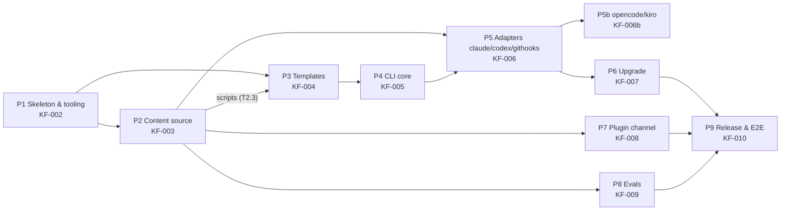

# Plan — Kuanflow v0.1 build

Conventions
- Task ID `T<phase>.<n>`; spikes `S<n>`. Each phase gets its own work folder `KF-<NNN>-<phase>` (numbering below).
- Roles and "may write" paths as in the brief. A task touches ONLY the files listed.
- Estimates in agent-hours (wall time for one sub-agent incl. its own verify), excluding review.
- Every phase ends with: full verify suite → Adversarial review → DoD → commit → tag `v0.<phase>.0-dev` → Gate.
- VERSION is bumped to `0.<phase>.0-dev` at each phase end (Q-03).

## Full verify suite (`make verify`, grows per phase)

| Step | From |
|---|---|
| `uv run --project cli ruff check . && uv run --project cli ruff format --check .` | P1 |
| `uv run --project cli pytest -q` | P1 |
| `… pytest -q --cov=kuanflow_cli --cov-fail-under=80` | P4 |
| `bats tests/bats` | P1 (smoke) |
| `uv run --project cli python tests/check_skills.py plugins/kuanflow` | P1 (empty-tolerant) |
| `uv run --project cli python tests/check_versions.py` | P1 |
| `uv run --project cli python tests/check_schema.py` | P3 |
| `claude plugin validate ./plugins/kuanflow && claude plugin validate .` (skip w/ reason if `claude` absent) | P7 |

## Phase map, folders, dependencies

Phases are gated sequentially (one Gate per phase). P7 and P8 only depend on P2, so if you want to shorten the
critical path they can be pulled in right after P3 — not planned by default.

---

## P1 — Skeleton & tooling (KF-002) · est. 6 h

| ID | Role | Files | Deps | Acceptance criteria | Verify | Est |
|---|---|---|---|---|---|---|
| T1.1 | Coordinator | `docs/packaging.md`, `docs/playbook.md` (git mv) | — | Renamed; `git diff -M --stat` shows 100% similarity; no content change | `git show --stat -M HEAD` | 0.2 |
| T1.2 | CLI Eng | `cli/pyproject.toml`, `cli/src/kuanflow_cli/{__init__,main}.py`, `cli/tests/test_version.py`, `cli/uv.lock` | — | Python ≥ 3.11; deps copier, typer, pyyaml, tomlkit, rich, jsonschema; dev pytest, pytest-cov, ruff; version read from `../VERSION`; `kuanflow --version` prints it (PEP 440 form) | `uv run --project cli kuanflow --version`; pytest | 1.5 |
| T1.3 | Release/CI | `VERSION` (`0.1.0-dev`), `CHANGELOG.md` (Unreleased), `CODEOWNERS` (PKG §14, `<org>`), `Makefile` (`verify`), `.github/workflows/ci.yml` (skeleton running `make verify`), `tests/check_versions.py`, `tests/check_skills.py` (empty-tolerant stub with CLI contract), `tests/bats/smoke.bats` | — | `make verify` exit 0; `check_versions` compares VERSION ↔ CLI version (SemVer↔PEP 440) and accepts `--tag` | `make verify` | 1.5 |
| T1.4 | CLI Eng | `.gitkeep` dirs per PKG §4: `plugins/kuanflow/{skills,agents,commands,hooks,scripts,.claude-plugin}`, `templates/{project,knowledge-repo}`, `evals/{fixtures,trigger,behavior}`, `docs/adr`, `cli/src/kuanflow_cli/{patchers,adapters,migrations}` | — | `tests/test_layout.py` asserts §4 tree exists | pytest | 0.3 |
| S1 | CLI Eng (spike, scratch dir only) | scratchpad; result → `docs/adr/0002-copier-engine.md` | T1.2 | Proves: Copier `run_copy`/`run_update` as library against a synthetic local template repo with two tags; 3-way merge keeps a customisation; conflict produces inline markers; behaviour on dirty tree; `_skip_if_exists` semantics; exact pinned Copier version | spike script output pasted in ADR | 1.5 |
| S2 | CLI Eng (spike) | scratchpad; result → `docs/adr/0001-foundations.md` | T1.2 | Proves: wheel from `cli/` bundles `plugins/kuanflow` + `templates/` (hatch force-include); `uvx --from git+file://<repo>@<ref>#subdirectory=cli kuanflow --version` works offline-from-local; records verified tool versions (R0 table) and decisions Q-02/03/06 | spike output in ADR | 1 |

Parallel: {T1.1, T1.2, T1.3, T1.4} disjoint → parallel. S1, S2 after T1.2 (parallel to each other).
Exit: `make verify` green; layout test green; ADR-0001 + ADR-0002 accepted by you at Gate P1 (they fix engine design).

## P2 — Content source (KF-003) · est. 14 h

| ID | Role | Files | Deps | Acceptance criteria | Verify | Est |
|---|---|---|---|---|---|---|
| T2.1 | Test Eng | `tests/bats/{guard-bash,guard-protected-paths,load-config}.bats`, `tests/bats/helpers/` | P1 | One block + one allow case per SCR-03 rule; protected-paths: existing vs new file, config + local, special chars (spaces, unicode, `[`), no PyYAML → allow; load-config: silent w/o config, prints both layers, min_version warning, never non-zero. RED recorded | `bats tests/bats` (expect fail) | 2 |
| T2.2 | Release/CI | `tests/check_skills.py` (full), `tests/test_check_skills.py` + fixtures | P1 | Rules: SKILL frontmatter `name`==dir, non-empty `description` (≤ 1024 chars); agents `name`,`description`,`tools` ⊆ allowlist, read-only roles w/o Write/Edit; commands have `description`; no `mvnw|gradlew|npm run|./gradlew|mvn ` outside `<!-- kuanflow:example -->` fences in skills/agents/commands; banned patterns (Q-25) | `pytest tests/test_check_skills.py` | 2 |
| T2.3 | Script Eng | `plugins/kuanflow/scripts/{load-config,guard-bash,guard-protected-paths}.sh` | T2.1 | PKG §18.3–18.5 behaviour; English messages; executable; all T2.1 green | `bats tests/bats` | 2 |
| T2.4 | Content Eng | `plugins/kuanflow/skills/*` (10 skills + `clarify-requirements/checklists/fintech-questions.md`, `write-spec/templates/spec.md`, `write-postmortem/templates/postmortem.md`, `debug-incident/schemas/context.schema.json`) | P1 | PB §8.4–8.6 verbatim where given; others derived from PB W0–W10/§7/§13 only; step 1 = read effective config; stop-if-missing-key; `risk.fintech` gating; check_skills green | `check_skills.py` | 5 |
| T2.5 | Content Eng | `plugins/kuanflow/agents/*.md` (9) | P1 | PB §8.7 verbatim for 3; others from PB W3/§6.4 scope table; tool allowlist rule | `check_skills.py` | 1.5 |
| T2.6 | Content Eng | `plugins/kuanflow/commands/*.md` (12) | T2.4 | PKG §5.4 pattern; w4/w5/w6/w10 self-contained (Q-04); doctor per Q-17 | `check_skills.py` | 1.5 |
| T2.7 | Script Eng | `plugins/kuanflow/skills/debug-incident/scripts/collect_context.sh`, `tests/bats/collect-context.bats` | T2.4 (schema) | Q-07: local inputs, masks account_no/id/phone/email, ≤ 50 KB, output only under `.kuanflow/scratch/<id>/`, validates against schema, no network | `bats` | 1.5 |
| T2.8 | Content Eng | `plugins/kuanflow/README.md` | T2.4–T2.6 | lists skills/agents/commands; config-key contract | review | 0.5 |

Parallel: {T2.1, T2.2, T2.4, T2.5} then {T2.3 ∥ T2.6 ∥ T2.7}. Content (`plugins/kuanflow/{skills,agents,commands}`) and
scripts (`plugins/kuanflow/scripts`, `…/debug-incident/scripts`) are disjoint.
Exit: check_skills green; bats green for every guard rule; reviewer checks skills against PB text.

## P3 — Templates (KF-004) · est. 10 h

| ID | Role | Files | Deps | Acceptance criteria | Verify | Est |
|---|---|---|---|---|---|---|
| T3.1 | Test Eng | `tests/answers/{java-maven,java-gradle,node,python,other}.yml`, `cli/tests/template/test_render_project.py`, `cli/tests/template/test_render_knowledge.py`, `tests/check_schema.py` | P2 | Render each stack to tmp: §6.1 engine files exist, ownership-relevant files (`docs/adr/0000-template.md` etc.) present; `.kuanflow/config.yaml` validates against schema; commands match stack defaults; `use_orca=false` → no orca files; RED recorded | pytest | 2 |
| T3.2 | CLI Eng | `cli/src/kuanflow_cli/engine.py` (only `assemble_template()` + `render()`), `cli/tests/test_engine_assemble.py` | S1, T2.3 | Builds synthetic template git repo from `templates/project` + `plugins/kuanflow/scripts` at a given source dir; tags version | pytest | 1.5 |
| T3.3 | Template Eng | `templates/project/copier.yml`, `templates/project/template/**` (`.kuanflow/{config.yaml.jinja,README.md,templates/.gitkeep}`, `kuan-workbench/{work,wiki}/.gitkeep`, `docs/adr/0000-template.md`, `docs/runbooks/README.md`, `orca.yaml.jinja` conditional), `templates/project/blocks/{agents,claude,gitignore-*,pr-template,worktreeinclude}.md.jinja` (block bodies for patchers) | P2 | PKG §6.3 + Q-11 additions; `_skip_if_exists` per Q-13; no `_message_after_copy`; `kuanflow_version` default from VERSION; block bodies = PKG §6.5/§6.2/§18.8/§18.9 text + Q-16 addition | T3.1 tests | 3 |
| T3.4 | Template Eng | `templates/project/schema/config.schema.json` | — | JSON Schema draft 2020-12 covering CFG-01/02; `additionalProperties` allowed under project-owned sections only | `check_schema.py` | 1 |
| T3.5 | Template Eng | `templates/knowledge-repo/**` (copier.yml, postmortems/, runbooks-shared/, taxonomy.md, templates/, scripts/{build-index.py,stale-wiki-check.sh,check-frontmatter.py}, CI file) | — | Q-21 scope; check-frontmatter rejects missing `id/services/category/signatures/status` and unknown category | T3.1 knowledge tests + `bats` for stale-wiki-check | 2.5 |

Parallel: {T3.1, T3.3, T3.4, T3.5} parallel (disjoint: tests vs templates/** split by subdir); T3.2 parallel (cli/**).
Exit: render tests green for 5 stacks; schema check green; knowledge-repo render + frontmatter check green.

## P4 — CLI core (KF-005) · est. 18 h

| ID | Role | Files | Deps | Acceptance criteria | Verify | Est |
|---|---|---|---|---|---|---|
| T4.1 | Test Eng | `cli/tests/fixtures/build.py` (builds 5 fixture git repos: empty, maven+CLAUDE.md+.gitignore, gradle+.claude/settings.json, monorepo, spec-kit), `cli/tests/test_{init,dry_run,idempotent,personal,status,doctor,promote,uninstall,exit_codes,root}.py`, `cli/tests/patchers/test_*.py` | P3 | Encodes TST-08..11, 15, 16, OWN-01..06, CMD-01..08,18–25, MAN-01..07, Q-18, Q-22; byte-identity of user content outside blocks/keys; RED recorded | pytest | 4 |
| T4.2 | CLI Eng | `detect.py`, `root.py` | P3 | DET-01..07 + Q-20; root walk-up then git toplevel; `--root` | unit tests | 2 |
| T4.3 | CLI Eng | `manifest.py` | P3 | schema v1 + Q-22; read/write/diff; stable ordering | unit tests | 1.5 |
| T4.4 | CLI Eng | `plan.py` (change plan, diff, backup, apply), `patchers/{managed_block,json_keys,toml_keys,gitignore}.py` | P3 | Marker formats for md/html-comment/`#` files; insert/replace/remove; detect hand edit via hash; JSON/TOML key merge preserving formatting & order (tomlkit); backups under `.kuanflow/cache/backup/<ts>/` | unit tests | 4 |
| T4.5 | CLI Eng | `engine.py` (copy, clean-tree check, personal `.git/info/exclude`) | T3.2 | Copier run_copy via synthetic repo; dry-run renders to tmp and diffs | unit tests | 2 |
| T4.6 | CLI Eng | `main.py`, `commands/{init,status,doctor,promote,uninstall}.py`, `doctor.py` | T4.2–T4.5 | All T4.1 tests green; exit codes 0/1; coverage ≥ 80 % | full suite | 4.5 |

Parallel: {T4.1, T4.2, T4.3, T4.4} parallel (separate modules/files), then T4.5, then T4.6.
Exit (brief): §12.5 tests green on 5 fixtures; init idempotent; personal mode `git status` clean; coverage ≥ 80 %.
Note: until P5, `--agent` accepts no adapters (clear error, exit 1); doctor checks project-level items only.

## P5 — Adapters (KF-006) · est. 14 h  (+ P5b · 8 h)

| ID | Role | Files | Deps | Acceptance criteria | Verify | Est |
|---|---|---|---|---|---|---|
| S3 | Adapter Eng (spike) | ADR `docs/adr/0003-claude-adapter.md` | P4 | Verified on Claude Code 2.1.296: project skills/agents/commands paths, command invocation name (Q-16), settings hooks schema, relative vs `$CLAUDE_PROJECT_DIR` command path, `permissions.deny` syntax, `settings.local.json` for personal mode | commands + output in ADR | 1.5 |
| S4 | Adapter Eng (spike) | ADR `docs/adr/0004-codex-adapter.md` | P4 | Verified on Codex 0.162.1: `.agents/skills`, `.codex/agents/*.toml` format, `.codex/hooks.json` format + feature flag + trust, AGENTS.md reading | same | 1.5 |
| T5.1 | Test Eng | `cli/tests/adapters/test_{claude,codex,githooks,agent_add_remove,doctor_agent}.py` | S3, S4 | files in correct paths; only manifest keys touched; add→remove hash-identical (TST-14); tiers reported; Q-08 hook behaviour (pre-commit blocks modifying protected file, allows new; pre-push blocks main); personal variants; RED | pytest | 3 |
| T5.2 | Adapter Eng | `adapters/{base,registry,claude}.py` | T5.1 | ADP-01, ADP-06, ADP-08 | tests | 2.5 |
| T5.3 | Adapter Eng | `adapters/codex.py` (skills copy, agent md→toml) | T5.1 | ADP-02 | tests | 2.5 |
| T5.4 | Adapter Eng | `adapters/githooks.py` | T5.1 | ADP-05, Q-08 | tests + bats | 2 |
| T5.5 | CLI Eng | `commands/agent.py`, doctor `--agent` | T5.2–T5.4 | CMD-17, CMD-19 per agent | full suite | 1 |
| P5b | Adapter Eng + Test Eng | `adapters/{opencode,kiro}.py` + tests + ADR-0005 (verify on OpenCode 2.0.19 / kiro-cli 2.29.0) | P5 | ADP-03/04, Tier 2 reported | full suite | 8 |

Parallel: S3 ∥ S4; T5.2 ∥ T5.3 ∥ T5.4 (separate files; base.py owned by T5.2 and merged first).
Exit (brief): per-adapter tests; add→remove returns prior hash state; tiers correct. P5b has its own review + gate.

## P6 — Upgrade (KF-007) · est. 14 h

| ID | Role | Files | Deps | Acceptance criteria | Verify | Est |
|---|---|---|---|---|---|---|
| T6.1 | Test Eng | `cli/tests/upgrade/conftest.py` (synthetic `file://` source repo with v_old/v_new), `test_upgrade_{keeps_customizations,conflict_exit3,check,dry_run,keep_local,force,downgrade,migrations,dirty_tree,adapter_merge}.py`, `test_self_upgrade.py` (uv mocked) | P5 | TST-05, TST-12, TST-13, UPG-01..05, UPG-07, CMD-10..16; customisations from PKG §12.3.2 (Project specifics in AGENTS.md, new ADR, project skill); RED | pytest | 3.5 |
| T6.2 | CLI Eng | `sources.py` (resolve/fetch tags from `manifest.source`, cache) | T6.1 | latest = highest SemVer tag; offline file:// | tests | 2 |
| T6.3 | CLI Eng | `migrations/{__init__,runner}.py` + `migrations/test_noop` fixture migration | T6.1 | ordered, idempotent, recorded | tests | 2 |
| T6.4 | CLI Eng | `engine.py` (`update` via run_update), `commands/upgrade.py`, `commands/self_cmd.py` | T6.2, T6.3 | flow UPG-01; exit 3 on conflicts; manifest + doctor after | tests | 4 |
| T6.5 | Adapter Eng | `adapters/*` `plan_upgrade` with `git merge-file` (Q-09) | T6.1 | modified adapter file merges; conflict markers + exit 3 | tests | 2.5 |

Exit (brief): upgrade old→new keeps customisations, local-owned untouched; `--check` 2/0; plus real-tag test
(`v0.5.0-dev` → HEAD).

## P7 — Plugin channel (KF-008) · est. 3 h

| ID | Role | Files | Deps | AC | Verify | Est |
|---|---|---|---|---|---|---|
| T7.1 | Test Eng | `cli/tests/test_plugin_channel.py` (`claude plugin validate`, skip with reason if absent) | P2 | RED | pytest | 0.5 |
| T7.2 | Content Eng | `plugins/kuanflow/.claude-plugin/plugin.json`, `plugins/kuanflow/hooks/hooks.json` | T7.1 | PKG §5.2/§5.5, `<org>` placeholders, components at plugin root | validate | 1 |
| T7.3 | Release/CI | `.claude-plugin/marketplace.json` (no experimental entry), `tests/check_versions.py` extended | T7.1 | versions in sync | `check_versions.py` | 1 |

## P8 — Evals (KF-009) · est. 10 h

| ID | Role | Files | Deps | AC | Verify | Est |
|---|---|---|---|---|---|---|
| T8.1 | Test Eng | `evals/schema/eval.schema.json`, `cli/tests/evals/test_runner.py` (uses a fake `claude` binary on PATH) | P2 | YAML format PKG §12.4; assertions file_exists/file_contains/exit_code; runs/pass_threshold; skip w/ reason when `EVAL_API_KEY` absent; RED | pytest | 2 |
| T8.2 | Test Eng | `evals/run.sh`, `evals/run_all.sh`, `evals/thresholds.yaml`, `evals/runner.py` | T8.1 | deterministic scoring; JSON output; cost/turns recorded | tests | 3 |
| T8.3 | Test Eng | `evals/fixtures/spring-order-service/**` (fake code), `evals/fixtures/patches/{weakened-assertion,double-money}.patch` | — | compiles not required; patches apply cleanly (`git apply --check` test) | pytest | 3 |
| T8.4 | Test Eng | `evals/behavior/verify-flags-weakened-test.yaml`, `evals/behavior/fintech-double-money.yaml`, `evals/trigger/check-diff-before-pr.yaml` | T8.2, T8.3 | schema-valid | pytest | 1 |

## P9 — Release & E2E (KF-010) · est. 8 h

| ID | Role | Files | Deps | AC | Verify | Est |
|---|---|---|---|---|---|---|
| T9.1 | Test Eng | `tests/e2e/smoke.sh` (+ bats wrapper) | P6–P8 | `uvx --from <local path>#subdirectory=cli kuanflow` → init on fixture → doctor → upgrade (synthetic newer tag) → uninstall, all exit as expected | `bats tests/e2e` | 2 |
| T9.2 | Release/CI | `.github/workflows/{ci,release}.yml` full (PKG §18.6/§18.7 adapted: `bats tests/bats`, markdownlint scope, gitleaks, plugin-validate, gated evals), `tests/changelog_section.py` + test | — | actionlint-clean (if available) ; changelog extraction test | pytest | 3 |
| T9.3 | Release/CI | `README.md`, `docs/onboarding.md`, compat matrix, `CHANGELOG.md` | all | install/upgrade/rollback instructions with `<org>` placeholders | review | 3 |

---

## Risks
1. Copier-as-library behaviour (S1) may force a different engine design → resolved at Gate P1 via ADR-0002.
2. Codex/Claude adapter formats (S3/S4) may differ from PKG §9.6 → ADRs; untestable parts behind `TODO(verify)` + skip.
3. Content volume in P2 (31 markdown files) is the largest review load; reviewer compares against PB text.
4. Coverage 80 % from P4 applies to the whole `kuanflow_cli` package.

## Status (update before any context reset)
- Gate 0 approved 2026-10-12 (all recommendations). bats 1.10.0 installed.
- This plan = draft for Gate 1. Next after approval: create `KF-002-p1-skeleton/plan.md`, start P1 (tests first).
